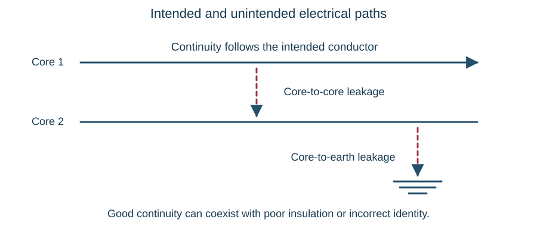

# Signalling cables

::: {.callout-note title="Learning objectives"}
Describe conductors, cores, insulation and sheaths; distinguish lineside, tail, power and interlinking cables; relate cable resistance to load performance; explain continuity and insulation evidence; and recognise how cable damage can affect a signalling function.
:::

## A cable is part of the circuit

Cables join the elements shown on a circuit diagram. They carry controls to equipment, indications back to the interlocking or display, and power to the loads. A cable fault can remove a required function or create an unintended path between functions.

An individual cable can contain circuits with different purposes. Losing several indications together can therefore point towards a shared cable, termination or supply. It does not prove that all the associated trackside items failed independently.

## What is inside a cable?

The **conductor** carries current and is commonly copper. A **core** is an individual insulated conductor within the cable. Its **insulation** electrically separates it from other cores and surroundings. The **sheath** protects the assembly from its environment; additional armour or other layers are included where specified.

| Part | Main concern |
|---|---|
| Conductor | Resistance, current capacity and mechanical integrity |
| Core insulation | Separation between the individual electrical paths |
| Sheath | Protection against moisture, contamination and physical damage |
| Armour, screen or other specified layer | The mechanical or electrical function defined by the cable design |

A sound-looking sheath does not prove that every conductor is intact. Conversely, visible sheath damage does not describe the full extent of the internal damage. Strand construction affects flexibility, while conductor area, insulation, installation conditions and protection all influence the permissible duty.

## Cable families and their roles

**Lineside cables** connect the interlocking area and trackside locations, or connect locations along the railway. Multicore arrangements can carry several controls or indications together. Some cores can be designated spare for future use or approved changes.

**Tail cables** connect a local housing to equipment such as signals, points, AWS apparatus or rails. They occupy an exposed part of the installation and have to accommodate the actual route and equipment interface. Track-circuit tail length and electrical characteristics can be part of the equipment design.

**Power cables** distribute the energy required by the equipment. A signalling distribution arrangement can use 650 V a.c. with local conversion, but the actual voltage and circuit must be established from the installation. Power cables must not be assumed to have unused spare cores.

**Interlinking cables** connect racks, rooms or operating equipment. Being within a building does not remove the need to identify their cores, terminal positions and circuit functions correctly.

Cable type, core count and appearance help recognition but do not prove identity. Use the markings and records associated with the actual cable.

## Core numbering and cable ends

Core numbers let the same conductor be identified at each termination. In a concentric multicore numbering arrangement, numbering progresses through layers outwards from the centre. Viewed into the cut face, the progression runs clockwise at the **A end** and anticlockwise at the **Z end**.

The ends present opposite views of the same laid-up cable. This convention helps interpretation, but it is not a substitute for reading the core identification. Different constructions can have different identification arrangements, so the applicable cable information must be used.

A core number, terminal number and wire-function identity are different things. Core 7 can connect terminal 12 at one location to terminal 18 at another. The record must preserve that relationship rather than silently treating all three numbers as equivalent.

## Voltage drop in signalling circuits

A point motor can impose a much larger current demand than an indication circuit. Resistance in the outgoing core, return core, contacts and terminations can therefore have different effects on the two functions. An indication that works with little current does not prove that the complete path can support the motor demand.

For a remote relay or signal lamp, compare the supply and load conditions through the complete path. A resistive termination can reduce the equipment voltage and heat under load while leaving apparent continuity. The [point-movement example](power-supplies.qmd#sec-point-supply-drop) applies these relationships to a signalling load.

## Routing and the mechanical environment

Cable routes can include troughing, buried sections, ducts and undertrack crossings. Tail cables pass into equipment housings through their designed entries and glands. Protection, support and allowance for movement matter at transitions between these arrangements.

Think about the path as well as the endpoints. A cable can be affected by tamping, excavation, sharp edges, unsecured lids, water, heat or equipment movement. Mechanical work near points and rail connections can affect both the cable and the equipment's reference position.

The [circuit-reading chapter](circuit-reading.qmd) explains how to follow a circuit across location boundaries. Combine that electrical route with the physical cable route when studying an installation.

## Recognising damage

| Observation | Possible significance |
|---|---|
| Cuts, abrasion or exposed inner layers | Loss of physical protection or insulation damage |
| Crushing, flattening or sharp distortion | Damaged conductors, insulation or both |
| Discolouration, melting or scorching | Heating from an electrical fault or an external source |
| Hardening, cracking or splitting | Deterioration of the sheath or insulation |
| Oil, chemical residue or other contamination | Possible material degradation and a handling hazard |
| Gnawing or disturbed protection | Animal damage that can extend beneath the visible surface |
| Corrosion or overheated terminals | Increased connection resistance or moisture-related damage |

Observation gives evidence; disturbing a suspect cable can change the fault or worsen its condition. Inspection and any handling must follow the work arrangements rather than treating a visible defect as permission to disconnect it.

## Continuity, identity and insulation answer different questions

A **continuity test** examines whether the intended conductor provides an unbroken electrical path. **Identification** establishes that the path is the intended core and terminates where the records require. **Insulation resistance testing** examines unwanted leakage between conductors or from a conductor to earth.

{#fig-cable-integrity}

A conductor can have good continuity and poor insulation at the same time. A cross-connected pair can also conduct perfectly while sending the function to the wrong terminal. A satisfactory result in one category cannot stand in for the others.

### Understanding a loop continuity measurement

On a disconnected teaching cable, two cores linked at the remote end make a loop that can be measured from one end. Its resistance includes both conductors, the temporary link and the test connections. A good loop reading alone does not separate the resistance of each core.

A reference core can support comparison with other cores, but its own identity and integrity first have to be established. Otherwise a fault in the reference can make several healthy cores appear faulty. Parallel paths through connected equipment can also give misleading apparent continuity.

This explains the test principle. The actual connections, isolation, instruments and sequence are defined by the authorised test arrangements.

### Understanding insulation evidence

Core-to-core insulation concerns separation between functions. Core-to-earth insulation concerns separation from the reference earth and surrounding conductive paths. The two results are not interchangeable.

Insulation resistance is affected by cable length, moisture, temperature and contamination, as well as the condition of the material. Compare records only when their units and relevant conditions are understood. Do not confuse a low resistance required along a conductor with the high resistance required through its insulation.

An insulation test applies its own voltage. Equipment connected to the cable can affect the result or be damaged by an unsuitable test. Instrument settings, selection of cores, treatment of connected equipment and acceptance criteria therefore come from the applicable instructions.

## Installation, periodic checks and restoration

Initial testing establishes the required evidence for a newly installed or replaced cable. Periodic testing provides evidence about deterioration during service. A previous satisfactory result does not prove that no damage has occurred since it was recorded.

Spare cores can be included in defined monitoring arrangements, but their results cannot establish the condition of every working core. The specified maintenance regime determines which observations and tests are required.

A job is not complete merely because a test reading is satisfactory. Terminal identity, restored connections, removal and accounting of temporary links, protection and the required functional tests all belong to the complete work and testing arrangements.

## Worked example: continuity without correct operation

A six-core teaching cable has core 4 broken and cores 5 and 6 transposed at the far end. A simple end-to-end check finds continuity on the conductors serving terminals 5 and 6, and the learner declares those connections correct.

The conclusion confuses continuity with identity. The paths conduct, but each reaches the wrong terminal. A test arrangement that proves the association between each end is needed to reveal the transposition. The break on core 4 is a separate fault; finding it does not prove that the other cores are correctly connected or adequately insulated.

## Key points

- A cable carries defined functions through identified conductors and terminals.
- Conductor integrity and insulation integrity are different requirements.
- The complete loop determines voltage drop; a high-resistance connection can heat under load.
- Core numbering must be related to the actual termination records.
- Testing includes correct preparation and restoration, as well as obtaining readings.
