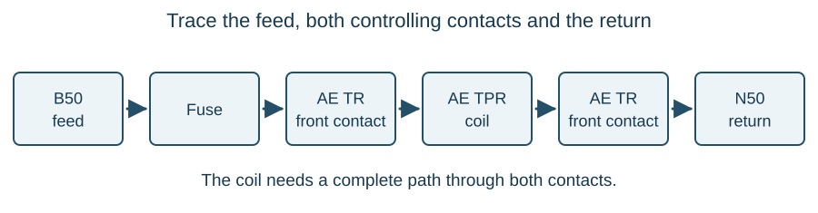

# Circuit reading

::: {.callout-note title="Learning objectives"}
Distinguish signalling plans, circuit diagrams and bonding diagrams; interpret equipment names and supply labels; trace complete and branching paths; follow references between sheets and locations; and explain red and green alteration markings.
:::

## Drawings communicate different kinds of information

A signalling circuit is both a logical arrangement and a physical network of equipment, wires and terminals. Reading it requires you to understand what the circuit is intended to do and how the actual connections achieve that function.

Three drawing types answer different questions:

| Drawing | Main question | Typical contents |
|---|---|---|
| Signalling or scheme plan | What equipment is provided, and where does it apply? | Tracks, signals, point identities, train-detection sections and operating directions |
| Circuit or wiring diagram | How are the electrical functions connected? | Contacts, coils, supplies, terminals, cable cores and sheet references |
| Bonding diagram | How are the individual rails electrically connected or separated? | Insulated joints, rail bonds, jumper connections and traction-return arrangements |

A scheme plan generally uses one line for each track. A bonding drawing needs the individual rail paths. Neither can replace the circuit detail needed to identify a particular relay contact or cable termination.

A schematic explains a principle with reduced detail. A working wiring diagram also identifies the connections needed for the installation. Always establish what kind of drawing you are reading before deciding what information it proves.

### Wiring layout and the written circuit

A wiring layout can group a relay's coil and contacts together, making the apparatus and its connections recognisable. A **written circuit** distributes the symbols into convenient feed-to-return paths, with function names identifying parts that belong to the same apparatus. Both can describe the same electrical connections while looking quite different on the page.

Converting between them is an exercise in preserving connections. Retain each terminal identity and junction, then follow the complete paths. Rearranging the symbols for clarity must not introduce a join where wires merely cross, omit a branch or exchange two contact terminals.

## Start with the title block and index

The title block identifies the installation, drawing number, sheet and revision. An index helps locate related sheets. Read these before concentrating on the circuit: a familiar-looking drawing for a different installation or revision can give a convincing but incorrect account of the equipment in front of you.

Build a small map of the drawing set. Locate the equipment circuits, supply and looping sheets, cable information, and rack or location profiles. The diagram containing a relay coil is not necessarily the sheet containing every contact of that relay.

## Symbol, identity and termination

A circuit element has three layers of information:

1. **Symbol:** what kind of electrical item or contact is represented?
2. **Identity:** which item performs this function?
3. **Termination:** exactly where does the connection enter or leave it?

For example, `AE TPR` identifies a track repeater relay associated with track circuit AE. `R1` and `R2` may identify its coil connections in a particular arrangement. A contact labelled `AE TPR A1-A2` belongs to that relay but represents a different pair of physical connections. The actual drawing determines the terminal designations; do not assume every relay uses the same coil pair.

The same equipment identity can occur many times because a relay has several contacts. Repeated identity does not mean that every symbol represents a separate relay.

### Read the whole symbol

The contact mark alone may be insufficient. The associated armature symbol, position letters, terminal designations and any timing or polarity notation distinguish different kinds of contact operation. A special symbol or reference number can direct the reader to a drawing note that supplies an essential condition.

Read those notes before assigning a state. In particular, a polar contact marked normal or reverse must be interpreted through the relay's specified operation and retention behaviour. The [relay contact and polar-relay explanations](relays.qmd) develop these distinctions. A neutral relay's simple up/down table cannot be applied to every symbol.

## Reading function names {#sec-function-names}

The final letter commonly identifies the apparatus, while preceding letters describe its function. The equipment number or track reference associates it with the railway item.

| Example | Interpretation |
|---|---|
| AE TR | Track relay for AE |
| AE TPR | Track repeater relay for AE |
| 23 ECR | Lamp-proving relay associated with signal 23 |
| 23 HR / HHR / DR | Yellow, double-yellow and green aspect-control functions |
| 345 NWKR / RWKR | Normal and reverse point-detection relays for points 345 |
| 345 NWKE / RWKE | Normal and reverse point-indication lamps for points 345 |
| WM | Point motor function in the applicable naming convention |
| T/J | Transformer-rectifier designation |

Letters have different meanings in different positions. An R can describe reverse or red within a name and identify a relay at its end. Parentheses or quotation marks can identify special functions. Use the drawing conventions and the relevant symbol and nomenclature reference rather than guessing an unfamiliar combination.

The [relays chapter](relays.qmd) develops the relationship between coil state, front contacts and back contacts. A front contact is not automatically closed just because it is called normal in ordinary conversation.

## Supply labels and protection

Supply labels follow their own convention. In a drawing using the following labels:

| Label | Meaning |
|---|---|
| B50 | Positive side of the identified nominal 50 V d.c. supply |
| N50 | Negative side of that supply |
| BX110 | Feed side of the identified nominal 110 V a.c. supply |
| NX110 | Return side of that a.c. supply |
| BN or BNX | An intermediate connection in the relevant supply arrangement |
| E | An earth connection where shown |

The number states a nominal voltage designation, not a measured result. B50 and N50 are the two sides of one labelled supply; the labels do not mean that each conductor has that voltage to earth. In an earth-free circuit neither side should simply be treated as an earth return.

Fuse identity and rating are separate information. `f007 3A`, for example, identifies fuse 007 with a 3 A rating. The rating is a protective-device characteristic, not the normal current drawn by every circuit it supplies.

## Trace the whole path

Start at the identified feed and follow the path through protection, controls, the load and the return. At every contact, ask which relay or mechanism operates it and what state makes it conduct. At every continuation, follow the stated reference rather than assuming that the line ends there.

For a simplified repeater circuit, the path can be written as:

**B50 → fuse → AE TR front contact → AE TPR coil → second AE TR front contact → N50.**

Both contacts must be made for the repeater coil to receive current. The second contact controls the return side; it is not a second source of power. This is an example of double cutting. Removing either required contact path prevents energisation in the ideal circuit.

{#fig-circuit-path}

The drawn order across the page makes the path easy to follow, but a wire may physically pass through several terminal strips and a cable before reaching the next element. Logical proximity is not physical proximity.

## Series, parallel and branching paths

Contacts in series all have to conduct for that path to be complete. Parallel branches provide alternative paths. A branch can also divide a shared feed between different loads, each with its own controls and return.

Do not confuse an alternative path around a contact with a separate load fed from the same junction. In the first case either branch may energise one coil. In the second, one branch can feed a lamp while another feeds a relay, and their remaining conditions may differ.

A **discrete circuit** has its own complete feed-to-return path. Several discrete circuits may appear on one sheet. Shared supplies can be shown through **positive looping** and **negative looping**, with a separate looping sheet identifying the fuse, connections and destination sheets. A circuit shown without the whole busbar arrangement still depends on those supply connections.

## Follow the boundary between locations

Incoming and outgoing describe direction relative to a stated location. A control can leave the relay room for a point machine, while detection returns from the point equipment. A circuit that is outgoing at one housing is incoming at another.

Follow both sides of the circuit across the boundary. Record the location identity, terminal, cable identity, core and receiving terminal. A matching function name alone does not prove that you have found the correct conductor.

Interlinking cables connect equipment within a relay room or between racks and the operating equipment. An interface can therefore exist within a building as well as along the railway. A rack or location profile helps turn the electrical identity into a physical position.

## Red and green alteration work

Alteration drawings distinguish the existing arrangement from work to be added or recovered:

- **Red** identifies new work or additions.
- **Green** identifies work to be removed or recovered.
- **Black** generally represents retained work, subject to the drawing's stated conventions.

An all-new sheet can be endorsed accordingly, while a sheet being recovered can carry an overall recovery marking. Complex work can use separate addition and recovery drawings. Colours must be read with the issue, stage, notes and endorsements; a greyscale print can conceal important distinctions.

Adding a connection to a spare contact of an existing relay does not necessarily mean installing a new relay. Likewise, removing wires from a contact does not necessarily mean recovering the relay. The markings identify what changes, down to the relevant connection or item.

::: {.callout-note title="Read an alteration as two arrangements"}
First establish the retained circuit with the green work removed. Then trace the completed circuit with the red work added. This helps expose a bypass, a missing return or an unintended change of logic without treating a coloured line as an isolated instruction.
:::

## Worked example: following a missing indication

An indication lamp is controlled by a point-detection repeater in a relay room. Its drawing refers to a separate looping sheet for the feed and to an interlinking cable for the lamp on the operating floor.

A learner looks only at the repeater contact and concludes that a closed contact proves the lamp should be lit. The conclusion omits the fuse and shared feed, the interlinking cores, lamp connections and return. It also assumes that the correct physical contact has been identified.

A complete account names the supply, fuse, controlling contact, intervening terminals, cable cores, lamp and return. If any part is uncertain, the explanation is incomplete. This is a drawing-reading exercise, not authority to disturb or test the operational circuit.

## Key points

- Different drawings represent the railway, the logic and the individual rail or wire connections.
- Identify the symbol, equipment function and terminals separately.
- Trace the complete path, including shared supply sheets and returns.
- Incoming and outgoing have meaning only relative to a location.
- Red and green describe alterations; drawing status and stage determine how to interpret them.
