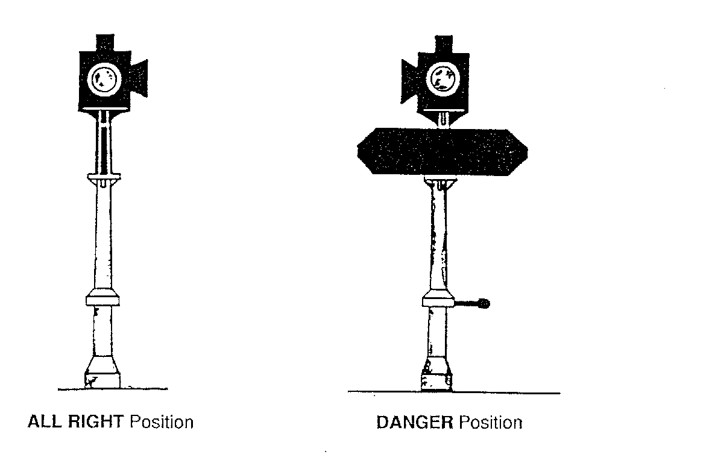
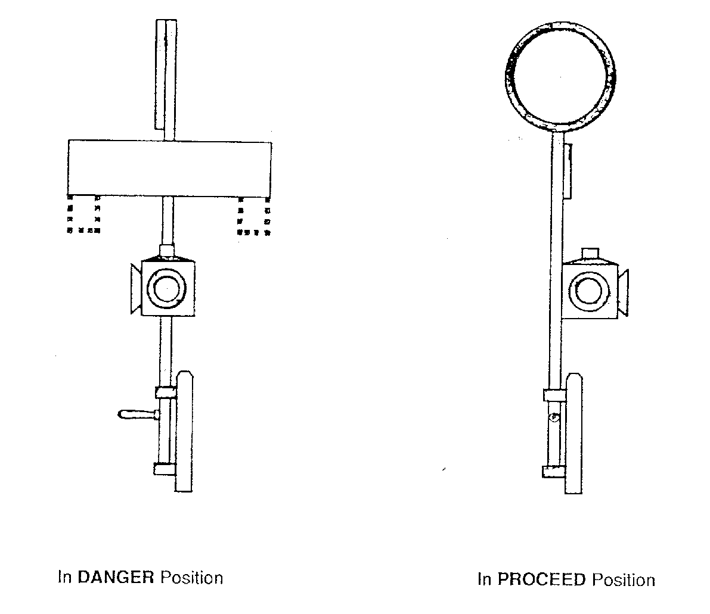
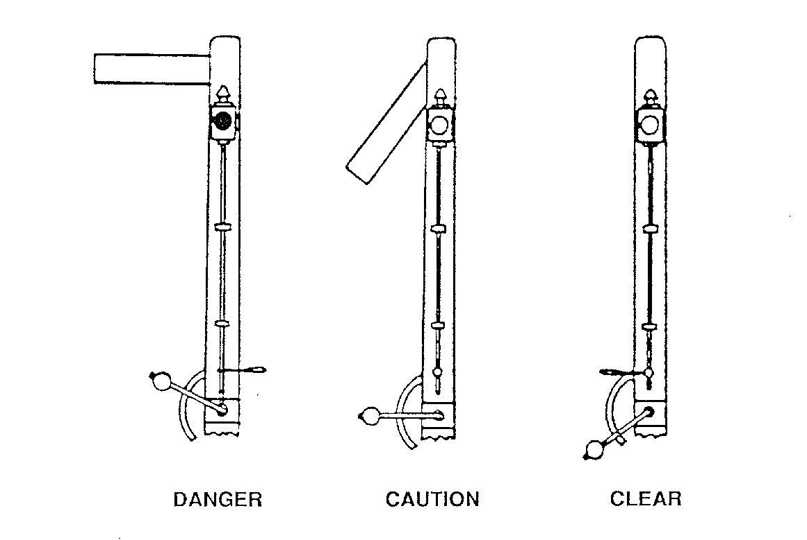

# History of signalling

::: {.callout-note title="Learning objectives"}
Explain how railway growth created a need for signalling; compare time-interval and space-interval working; recognise early fixed signals and the development of the semaphore; explain the lessons of Abbots Ripton; distinguish block working, interlocking and train detection; and relate mechanical, electrical and electronic systems to the principles used today.
:::

## Why study the history?

Many features of current railway signalling have their roots in the origins of the railways, as we are still trying to tackle the same problems: keeping trains apart whilst trying to run as many trains as possible. It would be easy to prevent collisions if there was only ever one train on the network at a time, but it would not be very useful.

Understanding how signalling came to be helps to explain why we have the processes and equipment that we do. Many improvements have followed accidents, and understanding those events helps to explain why the resulting protections matter. Some phrases have also survived from the beginnings of the railway, even where the equipment has changed completely.

This chapter develops the early history using the British Railways Board training manual *Brief History of Railway Signalling*, then follows the principles into later electrical and electronic systems. The early arrangements described here are historical examples.

## The first railways

Railways existed before the familiar steam passenger railway. Wagonways and early railways carried materials such as coal, often using horses. Their purpose was to improve transport between places of production and markets or waterways. Steam locomotives subsequently made it possible to haul heavier loads over longer routes, and regular passenger services added another reason to develop the network.

The Stockton and Darlington Railway opened on **27 September 1825**, with *Locomotion No. 1* hauling the opening train. The [National Railway Museum's account](https://blog.railwaymuseum.org.uk/shildon-the-cradle-of-the-railways-and-locomotion-no-1/) explains its significance. The [Liverpool and Manchester Railway](https://collection.sciencemuseumgroup.org.uk/people/ap48/liverpool-manchester-railway-co) opened on **15 September 1830**, following the Rainhill locomotive trials in 1829. These were important stages in railway development, rather than a single moment at which every feature of the modern railway appeared.

As more companies built lines, trains became more frequent and junctions more numerous. Passenger trains, goods trains and stopping services did not all travel at the same speed. A timetable could plan their movements, but a late-running train, an overloaded locomotive or a breakdown could quickly disturb the plan.

This created two linked requirements. The railway needed to establish where trains were allowed to go, and it needed a dependable way to tell drivers whether they could proceed. A timetable alone could do neither when events departed from the plan.

::: {.background}
Early railways also had to agree what time meant. Before standard railway time, clocks in different towns could show different local times. The British Rail manual describes inspectors finding different time references in use on the same railway. A common clock reference made timetables and records more useful, but even perfectly synchronised clocks could not prove that a train had cleared the line.
:::

## Local signals and the limits of time

Some early arrangements used a **time-interval system**. After a train passed, the following train would be held for a specified interval. A danger indication might be followed by a caution indication and eventually permission to proceed. The intervals and indications varied between railways.

Early railway staff used hand signals, flags and lamps to communicate with drivers. Railway policemen performed this work, which explains the nickname **bobby** for a signaller. Fixed signals subsequently provided a consistent place for drivers to look and allowed their position to be chosen for **signal sighting**. A signal could communicate the instruction more consistently, but it still needed a sound basis for deciding what to display.

The weakness of a time interval was that it assumed the first train continued to make progress. It might instead be moving slowly or standing just beyond a curve. Early arrangements therefore also depended on staff protecting a stopped train, for example by going back with a warning. Poor visibility and the time needed to reach a useful warning position limited that protection.

The important change was from asking **how long ago did the train leave?** to asking **has it cleared the section ahead?** The latter question requires information about a place beyond the signaller's immediate view. This is the difference between a time interval and a **space interval**.

### Worked example: a ten-minute gap

Suppose a railway holds a following train for ten minutes. The first train suffers a failure two minutes after departure and stops within the section. Eight minutes later, the prescribed interval has expired, but the train is still there.

Increasing the interval to fifteen minutes would change the delay before the second train departed. It would not prove that the failed train had moved. The engineering problem is missing information about the section, rather than simply an interval that is too short.

## From boards and discs to semaphores

The earliest fixed signals did not all look like the signals familiar today. Boards, discs, crossbars and lamps appeared in different combinations. Some gave a danger indication by turning a board towards the driver and permission to proceed by turning it edge-on.

{#fig-history-board fig-alt="Two views of the same early signal: a board edge-on for all right and facing the driver for danger." width="620"}

The word **board**, sometimes used for a signal, reflects this history. The difficulty with an edge-on clear indication is that the driver sees very little of the signalling surface. An absent or obscured board could be confused with a board deliberately turned out of view.

### A positive indication

The Great Western's disc-and-crossbar arrangement provided a visible shape in both states: the crossbar for danger and the disc for proceed. The manual also notes that a disc could mean stop on another railway. Drivers therefore needed to understand the conventions of the railway on which they were working; recognising a shape alone was insufficient.

{#fig-history-disc fig-alt="Historical Great Western signal shown with a horizontal crossbar for danger and a circular disc for proceed." width="620"}

These examples introduce a lasting design question: **what positive evidence distinguishes permission from missing information?** Later designs increasingly sought to make permission depend on a definite indication and on the required conditions being established.

### The semaphore

The manual identifies Charles Hutton Gregory's semaphore on the London and Croydon Railway in **1841** as an important early example. Its moving arm made the indication recognisable by position. A lamp and coloured glasses, known as **spectacles**, provided corresponding indications at night.

An early slotted-post form had three arm positions. The horizontal arm indicated danger, an inclined arm indicated caution, and an arm lowered into the post indicated clear. These are historical indications, not the two-position operation of later stop and distant semaphores.

{#fig-history-slotted fig-alt="Three early semaphore positions: horizontal for danger, inclined downwards for caution, and concealed in the post for clear." width="680"}

The slot made the arm difficult to see in the clear position and created a place where snow could interfere with its movement. The later history of the semaphore shows why the behaviour of the complete mechanism mattered as much as the intended meaning of its positions.

## Telegraphs and block working

The electric telegraph made rapid communication between distant railway locations possible. In 1839, Cooke installed a demonstration telegraph between Paddington and West Drayton. The [London Museum's account of railway telegraphy](https://www.londonmuseum.org.uk/collections/london-stories/how-telegraph-took-off-victorian-london/) explains how the railway became an early application of this technology.

Block working used communication between adjacent controlling locations to organise trains through defined sections. Instead of relying on elapsed time, staff exchanged information about whether a section could accept a train and whether a train had cleared it. Instruments displayed the section's state, while bells conveyed messages. The British Rail manual describes an early electric telegraph block installation on the Norwich to Yarmouth line in 1844; adoption elsewhere was gradual.

This introduced a lasting distinction: **communication supplies information; the working arrangements establish how that information is used**. A wire between two boxes did not by itself guarantee separation. Correct identification, acceptance and confirmation that a train had arrived complete were also important.

On single lines, opposing trains created a further problem. Staffs, tablets and tokens provided physical authority associated with a section. Electric token instruments developed the principle by controlling the release of tokens between locations. The detailed arrangements differed, but the aim was to prevent incompatible authorities being issued.

:::: {.callout-note title="Activity: what does the message prove?"}
A locomotive reaches the next signal box, but some wagons have become detached behind it. Why is seeing the locomotive insufficient evidence that the section is clear?

::: {.callout-note collapse="true" title="Suggested reasoning"}
The complete train must have left the section. Arrival of its leading vehicle gives no assurance about vehicles left behind. This explains the importance of establishing train completeness in traditional block working.
:::
::::

## Signal boxes and mechanical interlocking

Initially, staff worked signals and points at separate locations. Connecting signals by wires to a group of levers reduced the walking needed and allowed one person to control more equipment. Bringing point and signal controls together then made it practical to link their operation.

Concentration alone did not prevent mistakes. A signaller could still try to clear a signal with its points incorrectly set, or attempt to authorise conflicting movements. What mattered was enforcing the relationship between the controls.

Mechanical interlocking used the relative positions of levers and locking components to prevent specified combinations. Point movement was transmitted through rods and cranks; signals could be worked through wires. The lever frame's locking made certain incorrect sequences physically unavailable.

The manual traces development through Gregory's early central frame at Bricklayers Arms, John Saxby's **1856** interlocking patent and subsequent arrangements enforcing a sequence of separate operations. The important progression was from grouping controls together to requiring one movement to be completed before a dependent movement could begin.

For example, the required point setting must be established before the associated signal can be cleared, and the points must be prevented from moving while the authorised movement requires them to remain secured. This is a relationship between the equipment states, rather than simply an instruction to the signaller to remember the correct order.

Signal boxes developed with an operating floor above a locking room, giving the signaller a view of the railway and space below for the mechanism. [Historic England's *Signal Boxes*](https://historicengland.org.uk/images-books/publications/iha-signal-boxes/heag137-signal-boxes-iha/) describes their development and the relationship between the building, lever frame and block instruments.

Block working and interlocking answered different questions. Block working addressed the separation of trains along a line. Interlocking addressed the compatibility of points and signals within a layout. Both were needed: correctly set points did not establish that the line ahead was clear.

## Abbots Ripton: when the lever and signal disagreed

On **21 January 1876**, a serious accident occurred on the Great Northern Railway at Abbots Ripton. In heavy snow, signals did not reliably return to danger when the signallers moved their levers. An express collided with a coal train being shunted clear of its path, and a train approaching on the other line subsequently struck the wreckage.

The British Rail manual uses the accident to explain a weakness of the slotted-post semaphore. Snow and freezing conditions could impede movement of the arm and mechanism, leaving a misleading clear indication despite a danger command. The [Board of Trade court of inquiry report](https://abbotsripton.net/AbbotsriptonAccident/BoT_AbbotsRipton1876_Transcript.pdf) records evidence of this disagreement between lever position and the indications outside.

The lesson connects directly to the distinction between **command, action and indication** in the [Railway signalling](railway-signalling.qmd) chapter. Moving the lever was the command; the arm returning to danger was the required action. The driver's indication depended on what the arm and spectacle actually did.

Later semaphore development addressed the susceptibility to snow and the balance of the arm. The Great Northern adopted the somersault signal, with an arm standing clear of the post. Other arrangements used suitable counterbalancing so that specified failures of operating connections would tend to return the signal to danger. This was a development in how the equipment behaved when something went wrong, as well as a change in appearance.

::: {.callout-important title="The engineering lesson"}
An instruction to stop is useful only if the equipment conveys it. A control's position must not be mistaken for proof that the controlled equipment has completed its movement. The same distinction matters when a modern screen records a command but a point machine or signal has not achieved the required state.
:::

### Stop signals and distant signals

Semaphore development also made different functions easier to recognise. A stop signal controls whether a train may pass it. A distant signal gives advance information about the stop signals ahead; it is not a substitute for them.

Early distant signals could use red indications, making their warning function difficult to distinguish from a stop instruction, especially at night. The later familiar distant combined a fishtail arm with yellow colouring and yellow or green lights. The change illustrates the importance of distinguishing functions by the indications available to the driver, rather than by location knowledge alone. [Lineside signals](lineside-signals.qmd) develops the later arrangements.

## The 1889 legislation

The [Regulation of Railways Act 1889, section 1](https://www.legislation.gov.uk/ukpga/1889/57/pdfs/ukpga_18890057_en.pdf) empowered the Board of Trade to require block working, interlocking of points and signals, and continuous brakes on passenger trains. These were complementary protections: controlling entry to a section, preventing incompatible settings and providing effective braking.

The Act was a major historical step towards wider adoption. It did not invent those protections, nor did it cause every railway to acquire identical equipment on the same date.

By this stage, many companies had already installed substantial amounts of block signalling and interlocking. Legislation helped extend protections more consistently. Adoption, accidents, inspection, engineering development and legislation all contributed to change; the history is not simply a list of inventions replacing one another.

### Milestones in the early development

| Date or period | Development | Problem it helped address |
|---|---|---|
| 1825 and 1830 | Opening of the Stockton and Darlington and Liverpool and Manchester railways | Growth of public railways and regular train services |
| 1830s and 1840s | Different forms of fixed signals | A consistent place and recognisable means of communicating with drivers |
| 1839 onwards | Railway electric telegraph applications | Communication beyond the immediate view of local staff |
| 1841 | Gregory's early railway semaphore | A signal indication expressed by the position of an arm |
| 1840s onwards | Development of telegraph block working | Separation based on a section's availability rather than elapsed time |
| 1850s onwards | Development of mechanical interlocking | Preventing incompatible point and signal settings |
| 1876 | Abbots Ripton accident | Exposed the consequences of a danger command failing to produce a danger indication |
| 1889 | Regulation of Railways Act | Powers to require block working, interlocking and continuous brakes |

The developments overlapped. A railway might acquire telegraph communications before adopting comprehensive block working, and fixed signals could exist without interlocking.

## Train detection adds information from the track

Traditional block arrangements depended heavily on observation and communication. A track circuit added an electrical means of obtaining information about occupation. The rails formed part of a circuit, and the train's wheels and axles changed its electrical condition.

The [Science Museum Group's record of an 1898 DC track relay](https://collection.sciencemuseumgroup.org.uk/objects/co27829/d-c-track-relay-1898) places the successful closed-circuit application in the United States in 1872. Its [1912 signalling-school track circuit indicator](https://collection.sciencemuseumgroup.org.uk/objects/co8430674/track-circuit-indicator) shows how occupation information was used in training.

Detection could be incorporated into signal controls and locking, giving the system information beyond the positions of the signaller's levers. It also supported automatic signals responding to conditions ahead.

For technicians, this added a new set of interfaces: rails, bonds, insulated joints, ballast, electrical supplies and relays. Later axle counters obtained occupation information by counting axles at section boundaries. Both belong to the subject of [train detection](train-detection.qmd), although they obtain their evidence differently.

## Electrical operation, colour lights and relay logic

Mechanical operation placed practical limits on distances and operating effort. Power-operated points and electrically operated signals allowed the source of operating energy to be located near the equipment. Electrical circuits could carry controls and indications between that equipment and a more distant control point.

Colour light signals communicated through illuminated aspects. Multiple-aspect arrangements could provide advance warning of a stop signal ahead. The required sequence still depended on the railway's braking and operating conditions; electrical operation did not remove those constraints.

Relays also allowed interlocking conditions to be implemented in circuits. A relay contact could represent a required condition, and a combination of contacts could prevent an output unless the designed conditions were satisfied. The safety purpose remained related to that of mechanical locking, although its engineering implementation changed.

Panel control and entrance-exit route setting changed the signaller's task. Rather than operating each point and signal separately, the signaller could request a route between two locations. The request still depended on the interlocking obtaining the necessary proofs.

::: {.callout-tip title="A link to circuit reading"}
A modern-looking control panel does not tell you what type of interlocking lies behind it. Identify the control system, interlocking and trackside equipment separately when studying an installation's drawings.
:::

## Warnings and train protection

Interlocking could prevent incompatible permissions, but it could not guarantee that a driver would observe and respond correctly to every signal. Warning and protection systems addressed this additional risk.

AWS provides an in-cab indication and requires acknowledgement of a warning, with a brake application if it is not acknowledged. TPWS adds automatic brake intervention in defined circumstances, including certain overspeed and signal-overrun conditions. Their functions and application are described in [RSSB's AWS and TPWS application requirements](https://www.rssb.co.uk/standards-catalogue/CatalogueItem/RIS-0775-CCS%20Iss%203).

These systems illustrate the development of additional protections around the basic signalling system. A warning does not prove a route, and acknowledging it does not establish that the train is travelling at a safe speed.

## Electronic interlocking and signalling centres

Solid State Interlocking (SSI) and later computer-based interlockings implemented safety logic using electronic equipment, software and installation-specific data. The equipment changed, but it still needed information about train occupation, point position and the other conditions governing movements.

The [Office of Rail and Road's 2021 signalling market study](https://www.orr.gov.uk/media/22330/download) records electronic interlockings commissioned from 1985 and describes mechanical and relay equipment as part of the older installed base. This overlap matters: signalling development is a process of renewal and integration, rather than an immediate replacement of one complete railway by another.

Remote control and workstation interfaces allowed geographically separated areas to be operated from signalling centres. A communications fault, an interlocking fault and a trackside equipment fault could consequently produce related symptoms at a distant screen. Technicians needed to understand both the individual equipment and the links between systems.

## Cab signalling and digital train control

Cab signalling brings movement information into the driver's cab. The European Train Control System (ETCS) also supervises the train against the movement authority and speed information it receives, with brake intervention when required.

Network Rail describes ETCS, traffic management and their supporting telecommunications as distinct technologies within its [Digital Railway programme](https://www.networkrail.co.uk/our-work/railway/digital-railway/proven-technology/). Moving information to a screen does not remove the need to detect trains, secure routes or prove point positions. Those functions remain part of the complete system.

Electronic interlocking, remote control, automatic route setting and cab signalling should therefore be understood separately. An electronic interlocking can control lineside signals; cab signalling does not by itself imply moving-block operation.

## Worked example: three generations, one requirement

A junction's points must be correctly positioned before a train is authorised over them. Consider how three generations of equipment address that requirement:

| Arrangement | How the requirement appears | What the technician needs to distinguish |
|------------------------|------------------------|------------------------|
| Mechanical installation | Lever-frame locking and the installation's point-locking and detection arrangements | Lever position, transmission movement and actual point condition |
| Relay interlocking | Point-detection conditions included in the relevant control circuits | A point command, physical movement and the detection circuit's state |
| Electronic interlocking | Inputs and application logic controlling whether authority can be given | The command, equipment state, interface information and interlocking decision |

These are teaching comparisons, not interchangeable maintenance instructions. In each case, knowing that the operator requested a route is insufficient evidence that the points completed the required movement and locking.

## Key points

- Railway growth exposed the limits of timetables and local observation as means of controlling trains.
- A fixed signal gives a consistent place to look; it does not by itself establish that the line is clear.
- Block working replaced reliance on elapsed time with control based on defined sections.
- Interlocking prevented specified incompatible settings and movements.
- Abbots Ripton demonstrates why a danger command must result in the required physical indication.
- Train detection added information obtained from the railway itself.
- Electrical and electronic systems changed how controls were implemented and how far they could reach.
- Warning and protection systems addressed risks beyond the issue of a correct signal permission.
- Older and newer technologies can coexist; understand the interfaces as well as the equipment.

## Check your understanding

1. Why could increasing the time interval between departures fail to prevent a collision?
2. What was the weakness of giving permission by turning a signal board edge-on?
3. Why did the telegraph help the development of block working?
4. What did Abbots Ripton show about the relationship between a lever and its signal?
5. Why could mechanical interlocking not, on its own, prove that a train had cleared the section ahead?
6. What additional information did track circuits provide?
7. Why does replacing a lever frame with a workstation not identify the type of interlocking?
8. Which requirement remains common to all three generations in the worked example?

::: {.callout-note collapse="true" title="Suggested answers"}
1. A stopped train could remain in the section after any prescribed interval had expired. Time alone gave no proof of clearance.
2. A deliberately edge-on board could be difficult to distinguish from missing or obscured equipment. A visible indication for each state provided better information.
3. It allowed distant controlling locations to exchange information promptly, supporting decisions about entry to sections.
4. A lever could be moved to command danger while the external mechanism failed to display it. The command and resulting indication had to be considered separately.
5. Locking between levers established permitted combinations within its design; section clearance required separate evidence and working arrangements.
6. They provided an electrical indication of the state of a defined track section, which could be used in controls and indications.
7. A workstation is the operator's interface. It can be connected to different forms of interlocking through suitable interfaces.
8. The required point position and locking must be established before the movement is authorised.
:::

## Sources and further reading

- British Railways Board, Signal & Telecommunications Engineering Department, *Introduction to Railway Signalling: Brief History of Railway Signalling*. Supplied scan, with pages dated September 1991 and revised pages dated February 1992. The early railway narrative draws on printed pages 1-10; the historical illustrations reproduce Figures 6-8. This is a historical training source.
- [National Railway Museum: Shildon, the cradle of the railways and Locomotion No. 1](https://blog.railwaymuseum.org.uk/shildon-the-cradle-of-the-railways-and-locomotion-no-1/).
- [Science Museum Group: Liverpool and Manchester Railway Company](https://collection.sciencemuseumgroup.org.uk/people/ap48/liverpool-manchester-railway-co).
- [Historic England: Signal Boxes](https://historicengland.org.uk/images-books/publications/iha-signal-boxes/heag137-signal-boxes-iha/).
- [Board of Trade: court of inquiry into the Abbots Ripton collisions, 1876, transcription](https://abbotsripton.net/AbbotsriptonAccident/BoT_AbbotsRipton1876_Transcript.pdf).
- [Regulation of Railways Act 1889, as enacted](https://www.legislation.gov.uk/ukpga/1889/57/pdfs/ukpga_18890057_en.pdf).
