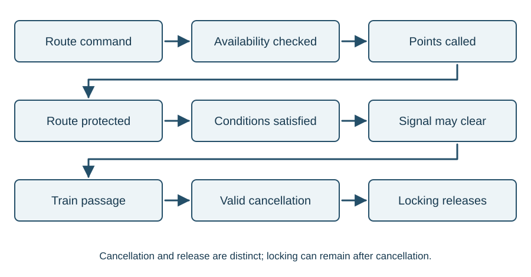

# Interlocking

::: {.callout-note title="Learning objectives"}
Follow route setting from availability to signal clearance; distinguish the main forms of locking; explain cancellation and release; and identify how control tables record the requirements.
:::

## From a command to a protected movement

Interlocking prevents incompatible routes, controls when points may move and determines when a signal may clear. It must maintain the required protection while a train approaches and traverses the route, and release it only under the specified conditions.

The entrance-exit interface simplifies entering the signaller's route command. It does not collapse the engineering process into one event. **Route commanded**, **route available**, **route locked** and **signal cleared** describe different stages.

{#fig-route-lifecycle}

## Availability before movement

First establish that the commanded route exists and that its required points are available. A point already in the required position may be available; a point locked in the opposite position is not. The availability check prevents unnecessary point movements for a route that cannot be established.

The system then calls the required points and establishes route locking. Point detection supplies the required indications to the signal controls. Availability and detection answer different questions: "may this point be used as required?" and "is the required state proved?"

## Route locking and conflicting movements

Route locking prevents the points being changed in a way that would destroy an established movement. Locking functions are associated with the successive train-detection sections of the route and overlap.

Some conflicting routes require a common point in opposite positions. Locking the point for the first route prevents availability for the second. Other conflicts cannot be excluded that way. In particular, opposing routes can use the same point positions while authorising trains towards one another. Directional route conditions must exclude that conflict.

White route indications and red occupation indications help the signaller follow the state. Their detailed meaning depends on the interface. They are information about the underlying functions, rather than the locking mechanism itself.

## Conditions for clearing the signal

For an invented main route from S1 to S3 over points P1, consider the simplified requirement:

**Route set and locked AND P1 detected reverse AND T1 clear AND T2 clear AND overlap O1 clear AND the required S3 proving satisfied.**

Each item has a purpose:

| Condition | What it establishes in this example |
|---|---|
| Route set and locked | The correct route exists and its required protection is established |
| P1 detected reverse | The required point state is proved |
| T1 and T2 clear | The route sections required clear are proved clear |
| O1 clear | The required overlap section is proved clear |
| S3 proving | The specified signal-in-advance proving is satisfied |

This is a learning expression, not a complete control table. Flank conditions, aspect sequence, approach controls and other requirements can also apply. If any required term is false, the expression does not permit clearance.

## Approach control and approach locking

These terms sound alike but serve different purposes.

**Approach control** regulates when a signal clears as the train approaches. For a junction with approach control from red, a signal is held at danger until an approach condition is satisfied so that the train has reduced speed before taking a divergence. Depending on the design, occupation, timing and aspect conditions can be involved.

**Approach locking** maintains route protection after a signal has been cleared and is then replaced. A driver may already have acted on the proceed aspect and may be unable to stop before the signal. Replacing it to danger does not mean that the route locking has released or that the route is immediately free to alter.

A release may depend on a look-back assessment, a timing condition, passage of the train or another designed sequence. No generic delay from an introductory example should be applied as a site instruction.

## Train-operated cancellation and sectional release

**Train Operated Route Release (TORR)** uses a defined sequence of train-detection operations associated with passage of the train. One occupied input alone is insufficient: a detection failure could otherwise mimic the event used to cancel a route.

Cancellation and release must be distinguished. A route can be cancelled while locking remains in force. Once the release conditions are met, **sectional release** removes locking behind the train in the specified sequence. A section ahead of the train must not become available merely because a preceding section has cleared.

A simplified learning sequence is:

1. The signal clears with the route protected.
2. The train passes the signal and the signal is replaced.
3. A valid passage sequence cancels the route command where TORR is provided.
4. Locking releases progressively as the required sections clear behind the train.
5. Remaining overlap or other locking releases under its own specified conditions.

Different layouts need different release conditions. The governing requirements are recorded for the actual route.

## Point locking has several causes

| Type | Purpose |
|---|---|
| Route locking | Preserve an established route or protected arrangement |
| Dead locking | Prevent point movement when the associated train-detection section is occupied |
| Individual-control or key locking | Hold points in a selected position through the control arrangement |
| Time-of-operation locking | Address movement timing where a train could reach points before a newly initiated movement finishes |

Dead locking and route locking can apply simultaneously. Waiting until the point section becomes occupied may be insufficient where the points are close to its boundary. Locking must address the train's approach and the equipment's movement time, rather than just its eventual position.

## Flank protection

A route can need protection from equipment outside its direct line of travel. Points in a siding or on an adjacent connection may be positioned and locked to prevent an unwanted movement reaching the route. This is **flank protection**.

The precise detection indications required depend on the arrangement. Do not assume that every flank point has the same detection requirements as a point traversed by the train. Read the specified controls, including any additional track-clear conditions associated with alternative protection.

## Overlaps and alternative paths

An overlap can include several sections and points. Trailing points can require a particular locked position. Facing points can provide alternative overlap paths if the design permits a **swinging overlap**.

A swinging overlap is a controlled change between valid protected arrangements. It does not mean that the points are unrestricted. Availability, detection, conflicts, timing and train occupation must all be addressed as required. Overlap release may also differ from route release, for example where a train stops at a platform and a later movement needs the points beyond it.

## Shunt routes and ground frames

A shunt route may not require every section up to its destination to be clear, because the movement can be intended to approach standing vehicles. This does not make its point detection or route protection optional. Each movement has its own requirements.

A ground frame provides local control of a limited group of equipment. A release from the controlling signaller enables the local operation under the specified protective conditions. Restoring the frame and its equipment to the required state is part of handing control back. A release is an engineered interface between two control arrangements, not merely permission conveyed by an indication lamp.

## Control tables

Control tables record the requirements for routes, points and other signalling functions. Signal-route entries include setting conditions, point and track proving, aspect controls, replacement, approach locking and train-operated release. Point entries describe movement restrictions, route locking, releases and overlap conditions.

Separate signal and point sheets organise the requirements by purpose. Start by identifying what a row or column governs, then relate each entry to the layout and the other tables. Do not infer a complete requirement from a fragment of circuit or software data.

## Worked example: cancelled but still locked

A signaller cancels a route just after a train has seen its proceed aspect. The signal returns to danger, but the points remain locked. Is the locking necessarily faulty?

No. Approach locking may be preserving the path for a train that cannot stop in time. If the train enters the route, its occupation and subsequent release sequence may continue to hold the necessary locking. The visible replacement of the signal is only one event in the complete process.

## Key points

- Availability, locking, detection and aspect control are different stages.
- Opposing routes can conflict without requiring opposite point positions.
- Approach control governs clearance; approach locking protects an approach after clearance.
- Cancellation does not automatically release locking.
- Control tables define the requirements for the actual arrangement.
