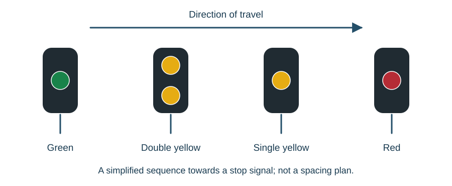

# Lineside signals

::: {.callout-note title="Learning objectives"}
Explain colour-light signal operation; relate aspect sequences to braking and headway; distinguish aspect selection, filament monitoring and lamp proving; describe route and subsidiary indications; and explain the operating principles of AWS and TPWS.
:::

## Communicating with the driver

An **aspect** is the indication displayed by a signal. Colour-light signals distinguish aspects by colours or combinations of colours. Position-light signals also use the arrangement of the lights. The meaning must be taken from the applicable signalling system, rather than from colour alone.

In route signalling, signals communicate movement information and route indications identify a divergence or destination. The driver also needs knowledge of the route and its speed restrictions. This differs from systems that use aspects to communicate specified speed categories directly.

A signal at its most restrictive aspect is said to be **on**. When it displays a less restrictive aspect it is **off**, or has **cleared**. Clearing does not necessarily mean displaying green: a signal displaying yellow has also cleared from red.

## Warning before a stop

A sequence of red/green stop signals needs an associated means of warning the driver about a red signal early enough to stop. Yellow/green distant or repeater signals can provide this warning in association with the stop signals.

The governing relationship is between the point at which the driver receives the warning and the location where the train must stop. Braking requirements depend on the trains and the railway, including gradient. Visibility of the red signal alone may not provide sufficient stopping distance.

A three-aspect system combines stop and warning functions at successive signals:

| Aspect in the simplified sequence | Information conveyed |
|---|---|
| Red | Stop |
| Single yellow | Be prepared to stop at the next signal |
| Green | The next signal is displaying a proceed aspect within this sequence |

A four-aspect system adds double yellow as an earlier caution in the sequence. A simplified progression towards a signal at red is green, double yellow, single yellow, red.

{#fig-aspect-sequence}

This is a principle diagram. It does not cover flashing aspects, special sequences or every possible installation.

## Overlaps

An **overlap** provides a defined distance beyond a stop signal as part of the protection for a train approaching that signal. In a simple plain-line arrangement, the signal in rear requires the appropriate section and overlap beyond the next stop signal to be clear.

The overlap is additional protection for an overrun; it is not an extension of the driver's authority to pass the stop signal. It can include points and more than one train-detection section. Those conditions must be dealt with by the interlocking.

## Headway

**Headway** is the separation between successive trains, expressed as a distance or as a time at a stated speed. A minimum-distance headway calculation must include the stated assumptions, such as train length, overlap, signal sighting allowance and braking distance.

For a simplified, evenly spaced plain-line arrangement:

$$H_3 = L + O + 2B + S$$

$$H_4 = L + O + 1.5B + S$$

Here $H_3$ and $H_4$ are the three- and four-aspect headway distances, $L$ is train length, $O$ is overlap length, $B$ is braking distance and $S$ is a sighting allowance, all expressed in the same distance unit. These simplified teaching relationships depend on the stated assumptions; they are not general design rules for all layouts.

For an invented example, take $L = 200$ m, $O = 180$ m, $B = 1{,}000$ m and $S = 200$ m. The results are $H_3 = 2{,}580$ m and $H_4 = 2{,}080$ m. At a constant 20 m/s, these distances correspond to 129 s and 104 s respectively. The reduction is 500 m, or 25 s at that speed. Actual service planning also depends on junctions, station stops, varying speeds and other constraints.

Adding intermediate signals does not halve every component of headway. Train length, overlap and sighting allowance remain in this simplified comparison.

## Inside a filament colour-light signal

In a separate-aperture filament signal, each aspect has a compartment containing its lamp, holder, electrical connections and optical system. Internal partitions prevent an illuminated lamp from lighting the lens of another aspect. The rear access and sealing arrangements protect these relationships from dirt, water and disturbance.

A double-filament lamp has a **main** and **auxiliary** filament with the required contacts and common connection. The holder fixes their position relative to the optical system. The correct lamp type and orientation matter: two lamps with similar bases can have different filament geometry or ratings.

The optical assembly collects and directs the light into the required beam. A long-range lens concentrates the light; a spread arrangement provides a wider viewing field where required. A **hot strip** directs part of the light towards the position of a driver close to the signal. Beam alignment is therefore more than pointing the outside of the housing towards the track.

Hoods, backgrounds and control of reflections support recognition of the intended aspect. A **phantom aspect** is an apparent illumination caused by extraneous light, such as sunlight, rather than the intended lamp. Maintaining sighting and optical integrity preserves the meaning of the electrical control.

### The electrical supply to the lamp

A filament arrangement can send an a.c. supply along the tail cable and step it down at an aspect transformer in the signal head. This reduces the current required in the longer cable compared with distributing the same power at the lower lamp voltage. The transformer and lamp connections still have to provide the specified conditions at the filament.

Separate tappings or connections can set the intended main and auxiliary operation. The lamp's nominal marking is not necessarily the specified operating value in the complete assembly. Adjustments, beam setting and holder position are governed by the applicable equipment instructions.

## Aspect selection, filament changeover and lamp proving

Three functions must be distinguished:

| Function | Question answered |
|---|---|
| Aspect control | Which aspect has been selected by the signalling logic? |
| Filament changeover and monitoring | Is the main filament available, and has the auxiliary been brought into use? |
| Lamp proving | Is the required aspect-current evidence present for the signalling controls? |

In a simplified four-aspect relay arrangement, the following states produce the normal sequence:

| Aspect | HR | HHR | DR |
|---|---|---|---|
| Red | Down | Down | Down |
| Single yellow | Up | Down | Down |
| Double yellow | Up | Up | Down |
| Green | Up | Up | Up |

The control logic enforces the intended progression. It does not normally allow an arbitrary combination such as DR up with HR down. These names and states explain the particular arrangement; other signal technologies implement the functions differently.

A local lamp relay can be energised by the main-filament current. If that filament opens, the relay releases and switches the supply to the auxiliary filament. Monitoring can report that the main filament has failed even though the signal remains illuminated.

The **ECR** lamp-proving function provides separate evidence used by the signalling controls. Its slow-release characteristic can bridge the short interruption during a legitimate aspect change or filament changeover, while a sustained loss removes the corresponding lamp-proving indication. The specified delay and proving path are part of the circuit design.

In the four-aspect arrangement described, the second yellow has a different proving treatment from the red, first yellow and green. Losing only the second yellow changes double yellow to the more restrictive single yellow. That example should not be extended to every multi-lamp display: some missing lamps can make a route indication ambiguous rather than simply more restrictive.

### Worked example: a lamp is lit but a filament alarm remains

A signal continues to display its selected aspect after its main filament fails. The auxiliary is carrying the required current, but a filament alarm is present. These observations can be consistent: changeover has preserved the display while monitoring reports the loss of the main filament.

The alarm and lamp-proving functions answer different questions. A visible light does not prove that both filaments are intact, while a main-filament alarm does not necessarily mean that the signal is dark. Read the particular lamp and proving circuit before interpreting either indication.

## Searchlight signals

A searchlight signal uses a lamp and an optical path with a moving coloured **roundel**. Its mechanism selects red, yellow or green within that path. In the arrangement considered here, the released mechanism selects red; energisation with one polarity selects yellow and the opposite polarity selects green.

Mechanism contacts repeat the roundel's position. Lamp-current proving and roundel-position proving are different evidence: a lamp can be illuminated while the colour-selection mechanism fails to reach its commanded position. A four-aspect searchlight arrangement adds a separate upper yellow to provide double yellow.

The lamp, reflector, roundel and lenses form the optical system. A reflector designed into that system must be understood with its associated controls and optical design, rather than applying a rule inferred from a different signal head. Main and auxiliary filament arrangements also have to maintain the intended optical alignment.

## Route indicators and signal sighting

A junction direction indicator, often called a **feather** or **route arm**, identifies a diverging route using an illuminated row of white lights. A theatre-type indicator displays a character identifying a route or destination. Their uses depend on visibility and operating context.

A route indication complements the signal aspect. It does not replace the need for the route to be correctly established. The controls must associate the indication with the route actually proved.

Physical signal design must make the intended display recognisable. Hoods, backgrounds, lens alignment and suppression of misleading reflections contribute to this. Plan symbols represent the signal's function and orientation; the exact physical installation requires more information than the scheme-plan symbol alone.

### Proving the route display

A junction indicator must produce a recognisable indication before the associated main aspect is permitted where route-display proving is required. A relay proving circuit can assess the selected lamp group through its designed current conditions. The number of lit lamps and their contribution to recognisability are equipment-specific.

A theatre-type display forms a character by illuminating selected lamp groups or an optical pattern. Some lamps are shared between different characters. Its controls must select the correct combination and obtain the required lamp-proving indication; finding current in any one lamp does not prove the intended character.

A stencil displays a fixed legend when illuminated. Alternative stencils need controls that prevent conflicting legends appearing together. Fibre-optic arrangements can carry light from a lamp to the positions that form the displayed pattern. The control path, light source, optical path and visible legend are distinct links in that chain.

## Shunt and subsidiary signals

Shunt signals authorise movements under a different set of conditions from a main running signal. A proceed shunt indication must not be assumed to prove the route clear to the same extent as a main running route. Some shunt movements are specifically intended to approach vehicles already standing on the line.

A **subsidiary signal** is associated with a main signal and can authorise a movement while the main aspect remains at danger. A **call-on** is a use that allows a train to enter an occupied line under the applicable conditions, such as entering a platform to join another train. The interlocking conditions are specific to the movement.

Other arrangements include preceding shunt signals, yellow shunts, opposing-locking-omitted arrangements and limit-of-shunt signals. These names identify specific purposes; they are not interchangeable variants of a universal shunting permission. In particular, a limit of shunt defines the limit of the relevant movement rather than providing a proceed aspect.

## Fitting a train into an occupied platform

**Lime Street control** uses the occupation of defined approach and platform sections to establish whether an approaching train can fit into the available space. Its logic depends on the relative lengths and occupation of those sections, not merely on a generic "platform occupied" indication.

Suppose the available platform section and a designated approach section have equal lengths. If the approaching train is standing at the signal but also occupies a further section behind that approach section, it is too long for the assumed space. The call-on conditions therefore exclude that state.

This is an example of translating a physical requirement into train-detection conditions. It must be understood from the actual layout and control requirements before its logic can be interpreted.

## Automatic Warning System

AWS combines track equipment and trainborne equipment to provide an audible indication and a visual reminder. In a standard signal-associated arrangement, the train receiver encounters a permanent magnet with its south pole uppermost and then an electromagnet which presents the required north-pole field when energised.

The permanent magnet initiates the warning sequence. The subsequent energised electromagnet produces the clear indication under the required signal conditions. If that cancelling field is absent, the driver receives the warning and must acknowledge it; failure to acknowledge initiates a brake application.

The cab's yellow-and-black **sunflower** or sunburst indication reminds the driver of an acknowledged warning. It is not a live repeat of the signal aspect: the signal can change after the train has passed the equipment. The driver still responds to the signals and route requirements.

For a permanent warning, such as a defined speed-restriction warning arrangement, a permanent magnet can be used without the signal-associated cancelling electromagnet. Bi-directional arrangements can require suppression and additional control of the magnetic fields so that the equipment has its intended effect for each direction.

### The inductor circuit

A relay-controlled AWS electromagnet can include both the green aspect-control condition and lamp-proving condition in its feed. The circuit therefore needs more than an instruction to display green. Both feed and return paths and the specified proving conditions must be followed when interpreting it.

An inductor stores energy in its magnetic field. A suppression diode or rectifier across the coil limits the switching transient when the current is interrupted, reducing arcing at the controlling contacts in the arrangement concerned. Its polarity and circuit connections form part of the design.

The track mounting, protecting ramp, magnet identity, direction and relationship to the associated signal are also functional parts of the installation. Correct electrical operation alone does not establish correct positioning or mechanical clearance.

## Train Protection and Warning System

**TPWS** provides defined brake-intervention functions through track loops and trainborne equipment. Its **overspeed sensor system (OSS)** uses an arming and trigger sequence on the approach. The elapsed time between the two is related to the train's speed and the loop separation.

In a simple timing model, passing the trigger while the onboard timing window is still active initiates an intervention. Greater separation gives a longer transit time at the same speed, so loop position is a functional part of the designed threshold. A **train stop system (TSS)** uses a closely spaced loop arrangement at the protected location to initiate the defined stop intervention when active.

The signalling interface controls the required active state and returns the specified fault or health information. An instruction to activate is different from evidence that the installation is functioning. A fault indication must be interpreted through the actual interface and its designed signalling response.

TPWS addresses specified locations and conditions; it does not guarantee that every train will stop before every possible conflict. Performance depends on the layout, approach conditions, equipment and train braking. Loop spacings, timing values, suppression and tests belong to the applicable design and equipment requirements.

## Key points

- Clearing means becoming less restrictive, not necessarily showing green.
- Warning distance must support stopping at the protected location.
- Four-aspect signalling adds an earlier warning stage; capacity depends on the whole arrangement.
- An overlap is protection, not movement authority.
- Shunt and call-on routes have purpose-specific controls.
- Aspect selection, filament monitoring, optical performance and lamp proving provide different evidence.
- AWS warnings and TPWS interventions depend on defined track-to-train arrangements.
