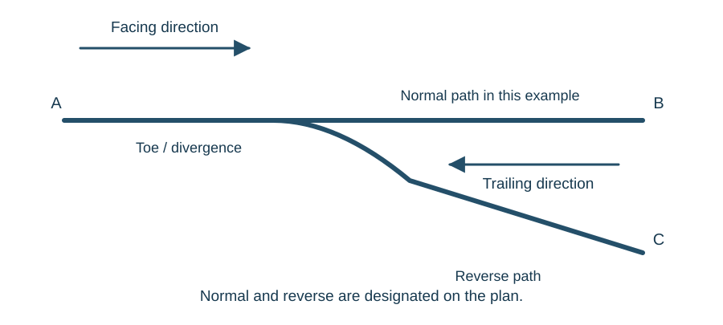

# Points

::: {.callout-note title="Learning objectives"}
Identify the main parts and rail forms of points; distinguish normal/reverse from facing/trailing; explain electric, EP and hydraulic operation; compare combined machines; and relate locking, detection, back drives and insulation to the complete layout.
:::

## Selecting a physical path

Points allow one track to divide into two, or two tracks to converge into one. The fixed outside rails are **stock rails**. The moving rails are **switch blades**, also called point blades. The moving end is the **toe**. Moving the blades closes one against its stock rail while opening the other to provide a flangeway.

Stretcher arrangements maintain the required relationship between the blades. Beyond them, the **crossing** provides the intersection of the rail paths. A fixed crossing includes gaps needed for wheel flanges. **Check rails** guide the wheelset through this area by acting against the back of a wheel flange, helping the opposite wheel follow the intended path at the crossing nose.

A turnout is therefore a coordinated assembly of moving and fixed track components. The machine is only one part of it.

## Rail form and switch fit

The stock rail can be bullhead or flat-bottom and can have an inclined or vertical arrangement. Switch-rail profiles include undercut, straight-cut and chamfered forms. The mounting and fittings must suit the actual rail and switch combination.

Where the stock rail is inclined, the switch rail need not have the same inclination. Looking only at the visible head or assuming that every turnout has the same section can therefore give an incorrect picture of blade fit and detector geometry.

Closure concerns the relationship of the closed switch to its stock rail. Opening concerns the space provided between the opposite switch and stock rail for the wheel flange. Both matter. A blade that is held clear at its toe does not automatically establish the correct shape and clearance over its whole working length.

## Two independent descriptions

**Normal** and **reverse** identify the two designated positions of the points. The designation is recorded on the plan. Normal must not be inferred merely because a route looks straight or appears to carry more traffic.

**Facing** and **trailing** describe the direction of a movement relative to the turnout. A facing movement approaches the toes and encounters the divergence. A trailing movement approaches from one of the converging tracks.

{#fig-point-directions}

| Movement in the illustrated example | Direction description | Required position |
|---|---|---|
| A to B | Facing | Normal |
| A to C | Facing | Reverse |
| B to A | Trailing | Normal |
| C to A | Trailing | Reverse |

Changing the normal designation on the plan would change the last column, not the facing/trailing descriptions.

## Crossovers, diamonds and slips

A **crossover** combines two point ends to connect adjacent tracks. The two ends may be operated under one identity. Their detection must establish the conditions required for the combined movement; seeing one end correctly positioned does not establish the state of the other.

A **diamond crossing** lets two tracks cross at the same level without providing a route from one into the other. A **switch diamond** replaces parts of the fixed crossing arrangement with moving rails. A **single slip** adds a connection around one side of a diamond; a **double slip** provides connections around both sides. A **scissors crossover** combines crossovers within a compact length and includes a crossing between them.

A **swing-nose crossing** uses a movable crossing nose to close the required running path. Where moving crossings are provided, the blades and crossing equipment must be correctly coordinated and proved for the route.

The learning task is to trace each possible path before counting point machines. Complex trackwork may have several moving parts serving one movement.

## Catch points and trap points

Spring catch points are intended to derail vehicles running back down a gradient. Trap points protect a running line against an uncontrolled movement from a siding or other connected line.

A trap arrangement provides protection by directing an unauthorised movement away from the line being protected. The derailing position can be its designated normal position. The fact that it leads away from usable track does not make it a mistaken setting.

These arrangements show that the safety purpose of a set of points may include protection from a movement as well as routing an authorised one.

## Drive, lock and detect

Power-operated points have three functions that must be distinguished:

| Function | Purpose |
|---|---|
| Drive | Supply and transmit the force to move the blades |
| Lock | Restrain the required parts in their established position |
| Detect | Provide the electrical evidence required by the interlocking |

In a typical electric point machine, a motor drives gearing and a mechanism that converts rotary motion into linear movement. A clutch limits the consequences of an obstruction. A lock mechanism follows a sequence of unlocking, moving and relocking. Separate detector connections follow the blades and operate the detection contacts.

The machine arrangement described here has four mechanical connections: one drive, one lock and a detector connection for each blade. They do different jobs. Motor rotation or completion of part of the drive stroke is not enough to prove that the whole turnout has reached the required state.

The mechanical reference is also important. If detection depends on the relationship between blades and a machine, the mounting and connection between the machine, rails and track support are part of the complete arrangement.

::: {.callout-important title="Detection is evidence with a defined meaning"}
A detection circuit is intended to prove specified mechanical conditions. Its validity depends on the complete arrangement, including its adjustment, connections and reference points. An indication is not a substitute for understanding those conditions.
:::

## Methods of operation

### Combined and non-combined electric machines

A **combined machine** brings the drive, locking and detection mechanisms into the machine assembly. External connections associate those mechanisms with the switch rails and stretcher arrangements.

A **non-combined machine** provides the movement while the lock and detector are separate items. In an SGE HA arrangement, separate operating connections drive the switches and a remote facing point lock, with a separate detector following the required conditions.

The distinction is about where the functions are implemented. Non-combined does not mean that the turnout can dispense with locking or detection. It means the complete equipment layout must be followed beyond the motor housing.

## HW machines

An HW mechanism uses a motor, gearing and a bevel gear to operate a throw bar through an escapement. A roller moving in the shaped escapement slot produces phases in which the lock mechanism moves while the throw bar remains stationary, followed by the movement of the switches.

The sequence has three functional stages:

1. **Unlock:** the mechanism withdraws the lock dog from the established lock notch.
2. **Drive:** the throw bar transfers the switch rails to the opposite lie.
3. **Relock and prove:** the lock dog enters the other notch and the detector mechanism establishes the specified final conditions.

Lock blades follow the lock connection, while detector blades follow the switches through their individual rods. Their final relationship is what allows the detection contacts to provide the required detection indication. The motor reaching a particular rotation cannot substitute for that relationship.

The HW 1000 and HW 2000 arrangements have different motor and clutch designs. The HW 1000 uses a split-field motor with a friction clutch in the arrangement described here; the HW 2000 uses a permanent-magnet motor and electromagnetic clutch. The clutch limits transmitted torque when movement is obstructed, but correct functioning still depends on the specified control and protection.

## Electro-pneumatic points

An electro-pneumatic (EP) machine obtains its operating force from compressed air. Electrical valves control that force. Loss of electrical control and loss of air pressure can therefore produce similar final symptoms through different paths.

A typical SGE arrangement includes an air motor, valve unit, escapement mechanism and detector. The air motor is a piston and cylinder. Applying pressure to one side while exhausting the other produces the required direction of movement.

The electrical needle valves provide the normal, reverse and lock-control functions. They operate control-air paths which in turn operate the main air valves. This lets relatively small electrical devices control the larger air flow needed by the motor.

In the normal sequence, the direction is selected and the lock-control function enables the air supply. The escapement coordinates unlocking, switch movement and relocking. When the required final conditions are detected, the operating pressure is removed and the cylinder is exhausted as designed. Mechanical locking preserves the established position; continuous air force is not a substitute for the lock.

A separate point detector follows both switch rails and the lock slide in the arrangement described. The supply reservoir, pipes, valves, piston, mechanism and detection connections are all relevant to an account of the movement.

### Worked example: valves called, no final detection

An EP direction command and lock command are registered, but the points do not reach valid detection. Several explanations remain possible: insufficient air supply, failure to admit or exhaust air, resistance in the mechanism, incomplete blade movement or a missing detection indication. The commands alone cannot distinguish them.

The useful study exercise is to follow **electrical command → valve action → air flow → piston movement → escapement and switch movement → locking and detection**. A missing final indication does not identify the detector as the only possible source of the failure.

## Clamp locks

A clamp lock arrangement uses hydraulic power to move drive-lock slides. The sequence first unlocks the closed blade, then transfers the blades, then clamps the newly closed blade to its stock rail. Detection is associated with the rail-mounted mechanism and includes conditions for both the closed and open blade.

This gives another implementation of the same functional sequence. It also shows why mechanical support, rail attachment and electrical insulation are important interfaces between permanent way and S&T.

The introductory comparison concerns operating principles. Product-specific adjustment values, motor run times, manual operation and tests belong in the relevant controlled equipment documentation.

### Components of the clamp-lock arrangement

A rail clamp-lock installation has a lock-and-detector mechanism associated with each side, drive-lock slides, actuators, a coupling arrangement and an electro-hydraulic power pack. The lock body references the stock rail, while the switch carries the parts that move with it.

The power pack drives the selected hydraulic actuator while allowing fluid from the opposite side to return. Initial slide movement releases the closed switch's lock arm. Continued movement transfers the switches. Final movement raises and supports the newly closed side's lock arm so that the blade is clamped and the required detection can be established.

The stretcher and coupling arrangements have distinct roles. In the mechanism described, the stretcher transfers the other switch while the coupling coordinates the drive-lock slides and the retracting actuator. Calling every connecting bar a drive rod obscures that sequence.

Track movement can change the relationships on which the mechanism depends. **Road spread** concerns a change in the relationship between the stock rails; **switch creep** is longitudinal movement of the switch relative to its reference position. Rail attachments and the permanent-way condition therefore contribute to the equipment's performance.

## Back drives and supplementary detection

A long switch requires controlled movement beyond the toe. A **back drive** transmits or supplies movement farther along the switch so that the closed rail fits and the open rail provides the required clearance over its working length.

Mechanical back drives use rods, cranks and supported connections. Hydraulic arrangements use additional actuators associated with the power pack. The number and positions depend on the turnout design; they cannot be inferred from the toe machine alone.

Supplementary detectors can provide detection indications farther along the switch. Toe detection and a back drive perform different functions: one reports defined conditions at its connection, while the other controls movement elsewhere. A satisfactory toe indication cannot automatically establish every condition along a long switch.

## Insulating the point fittings

A metal stretcher or sole plate can create an unwanted electrical connection between rail paths. Insulation within the fittings preserves the separation needed by the track circuit while retaining the mechanical connection.

Insulated arrangements can include divided sole plates and stretchers, bushes, ferrules, washers and insulation pieces at rods or fittings. An insulated ferrule separates the bolt from the surrounding metal; an insulating washer separates faces. Replacing only one part of that separation can leave another conductive path.

The required points include the switch and lock connections, detector rods and drive connections appropriate to the layout. A mechanically secure repair can still be electrically wrong if its insulation is defeated. Relate the fittings to the [bonding arrangement](train-detection.qmd) as well as to the point machine.

## What lock and detection tests establish

A **facing point lock test** establishes the specified relationship between switch fit and lock engagement. A **detection test** establishes the required relationship between the actual switch and lock conditions and the electrical indication. They address different links in the chain.

Testing has both safety and reliability purposes. The detection must not indicate the required position outside its permitted mechanical conditions, while the equipment must operate reliably within its permitted working tolerance. Setting everything as tight as possible can produce unreliable operation or mask the intended sequence.

The test positions, gauges, preparation and acceptance values depend on the mechanism and applicable specification. A point machine and a rail clamp lock do not necessarily use the same means of separating lock indication from switch detection during a test. Those procedures must be learnt from the equipment-specific instructions and carried out under the required authority.

## Worked example: one end detected

A crossover is commanded reverse. End A is reported reverse, but end B has no valid detection. Can the signal clear simply because the first end is correct?

No. The route depends on a continuous, correctly established path through both ends. If the required detection includes both ends, the interlocking is missing part of its evidence. A successful drive command and one end's indication cannot stand in for the other end's indication.

## Key points

- Normal/reverse are designated positions; facing/trailing describe movements.
- Points and crossings include fixed rails, moving rails and guidance through crossings.
- Drive, locking and detection are separate but coordinated functions.
- Combined, non-combined, EP and hydraulic equipment implement those functions in different arrangements.
- Back drives and supplementary detection address conditions beyond the switch toe.
- Trap points protect a line from an unwanted movement.
- The mechanical reference and electrical insulation form part of the signalling arrangement.
