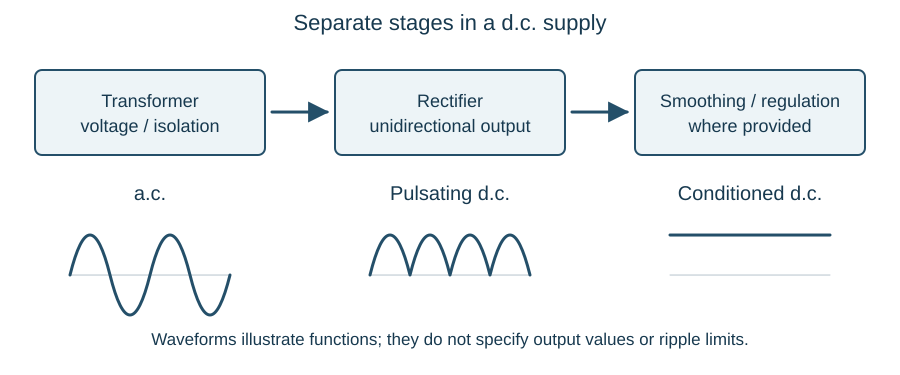

# Signalling power supplies

::: {.callout-note title="Learning objectives"}
Relate supply condition to signalling load and duty; interpret battery standby and charging arrangements; identify the roles of local conversion and isolation; explain alternative supplies and fuse discrimination; and follow a supply from its source to the load.
:::

## Start with the load

Signalling equipment needs energy as well as control information. A relay coil, a signal lamp and a point motor have different voltage, current and duty requirements. A supply must suit its connected load and remain adequate during the conditions for which the installation is designed.

A continuously energised relay imposes a steady demand. A point movement imposes a relatively large intermittent demand. A signal can change which lamp is energised while continuing to require a dependable supply. These patterns influence the choice of supply, protection, distribution and standby arrangements.

The main devices introduced here perform different jobs:

| Device | Main function |
|---|---|
| Cell or battery | Produce electrical energy through chemical action |
| Transformer | Transfer a.c. energy between windings and provide the designed voltage ratio and isolation |
| Rectifier | Convert a.c. into unidirectional current |
| Charger | Supply the controlled charging conditions needed by a rechargeable battery |
| Distribution and protection | Convey energy to the loads and control the consequences of faults |

A transformer-rectifier can supply d.c. equipment or form part of a charging system. Those functions do not make every transformer-rectifier a complete battery charger.

## Batteries in signalling supplies

A rechargeable signalling battery provides reserve when its normal supply is unavailable and, in some arrangements, supports intermittent equipment demands. Establish the battery type, nominal voltage, cell arrangement, charger and loads from the supply records. The way the cells or strings are connected affects the available voltage, capacity and charging requirements.

Battery identity matters when interpreting readings or selecting replacement equipment. A series string depends on every cell and intercell connection; a weak cell or resistive connection can limit the performance of the complete supply. Where parallel strings are provided, their intended current sharing and protection are part of the design.

### Primary cells: background

A **primary cell** supplies energy through a chemical reaction that is not intended to be reversed by charging; once exhausted it is replaced. Zinc-carbon dry cells and wet primary types have been used in signalling where a local self-contained supply was needed. They are useful background knowledge for interpreting older drawings, but the practical battery coverage in this book concentrates on rechargeable supplies.

## Battery voltage under signalling load

A satisfactory unloaded voltage does not prove that a battery can support its signalling duty. Internal resistance, cell condition and intercell connections can produce a marked voltage fall during a point movement or other demand. Distinguish a fall at the battery terminals from the additional drop between the battery and the equipment.

Record the load condition with the voltage. A reading taken while the battery is on charge, supplying its ordinary relay load or supporting a point movement describes a different condition. Compare the evidence with the applicable battery and equipment requirements.

## Standby capacity and discharge rate

The stated Ah capacity must be read with its rated discharge conditions and end voltage. The important signalling question is whether the battery can maintain its defined loads for the required standby period, including any intermittent demands. Temperature, age, state of charge and discharge rate affect usable reserve.

A battery can cease to support a relay, lamp or point machine before all its nominal capacity has been used, because the equipment's minimum input condition has been reached. Capacity, charger indication and open-circuit voltage are therefore different evidence about supply performance.

## Lead-acid cells

A lead-acid secondary cell has positive and negative plates separated within an acid-resistant container. Its electrolyte is dilute sulphuric acid. The chemical condition of the plates and electrolyte changes as the cell charges and discharges.

For accessible flooded cells, electrolyte **specific gravity (SG)** can provide evidence of charge state when interpreted with the cell type, temperature and condition. A hydrometer measures liquid density relative to water; SG is dimensionless, not a voltage reading. Designs with sealed or otherwise inaccessible electrolyte require their own assessment methods.

Prolonged discharge can allow persistent sulphation to develop, reducing usable capacity and increasing internal resistance. A battery's condition therefore cannot be established solely from its external appearance or the charger being switched on.

## Rechargeable alkaline cells

Rechargeable alkaline cells use an alkaline electrolyte, commonly potassium hydroxide in the types considered here. Their construction, voltage characteristics and charging requirements differ from lead-acid cells. [Nickel-cadmium](https://saft4u.saft.com/en/download_file/1a86081d-f49b-4d43-b3ce-b82f412ef33a/English) and nickel-iron identify different electrode systems and must not be treated as interchangeable names.

Electrolyte specific gravity does not track state of charge in the same way as in a lead-acid cell. A familiar hydrometer reading must therefore not be given the same interpretation across different chemistries. Battery identity is essential before interpreting test results or selecting charging equipment.

## Charging arrangements

**Initial charging** prepares a cell or battery for service where its supply condition requires it. **Recharging** restores charge after discharge. Neither has a universal current or duration applicable to all batteries.

A **trickle-charging** arrangement supplies a relatively small charging current, associated with replenishing charge between intermittent demands. The average load and charging capability must be compatible; a short operating cycle can create a high peak demand while drawing relatively little average current.

A **float-charging** arrangement maintains the battery at its specified standby charging condition while the supply supports the normal load. On loss of the normal supply, the battery can support the circuit for its designed duty. Correct voltage control and current capability remain necessary.

A regulated **constant-voltage charger** holds the designed output characteristic while its current changes with battery and load conditions, within its rating. Constant voltage does not mean constant charging current or unlimited output current.

Undercharging leaves insufficient reserve and can damage some chemistries. Excessive charging can cause heating, electrolyte loss and gas evolution. The charging system must match the battery, its application and the manufacturer's requirements.

## Local transformers

Signalling distribution can use a higher a.c. voltage with local transformers providing the supplies needed by lamps, track circuits and other equipment. Identify the primary supply, secondary circuit, rating and selected tapping from the actual installation. Conversion, isolation and the condition of the downstream circuit must all be accounted for.

Transformer tappings provide the designed output choices. Selecting a different tapping is not a general remedy for low voltage at equipment: first distinguish the transformer output from voltage lost in cables, contacts and terminations. A satisfactory no-load secondary voltage does not establish that the circuit remains adequate under its signalling load.

## Isolation and earth-free circuits

Isolation can separate a signalling supply from the earthing arrangement of its upstream source. In an **earth-free** circuit, an unintended connection to earth can remain hidden until another fault creates an unwanted path. The circuit's protective and monitoring arrangements are therefore part of the supply system.

An isolating transformer does not make every downstream part harmless to touch. A voltage still exists between its output conductors, and other sources or induced voltages can be present. The actual circuit and isolation arrangements govern the work.

## Transformer-rectifiers

A signalling transformer-rectifier combines local voltage conversion with a d.c. output for its specified equipment. Establish whether the installation also provides smoothing, regulation or battery charging; those functions cannot be assumed from a transformer-rectifier label.

{#fig-power-conversion}

A missing or defective stage can produce different symptoms: no output, low output, excessive ripple or inadequate performance under load. A label stating d.c. does not mean that the output has no ripple, and a correct no-load reading does not prove rated load capability.

## Follow the distribution path

A typical study path is **incoming supply → distribution and protection → local conversion → local protection → cable and terminals → load → return**. Add the battery and charger paths where provided. Identify which supplies and indications are shared by several items.

A signal transformer can have input voltage while its lamp circuit remains incomplete. Conversely, low voltage at a load can result from cable or terminal resistance rather than the power unit. The [cables chapter](cables.qmd) explains that distinction further.

## Alternative supplies and changeover

A second incoming supply and a local standby generator provide different forms of resilience. Two incoming feeders can still share an upstream dependency. A generator has its own dependencies, including starting energy, fuel, control equipment and the changeover path. Counting the available sources is therefore only the start of understanding supply security.

**Changeover equipment** transfers the load between the intended sources. The interval before the alternative supply is established matters: a generator cannot be assumed to deliver immediately after the normal supply disappears. A battery-backed circuit can bridge an interruption only within its designed capability. Follow which loads actually receive that support, rather than assuming that every load at a site is battery backed.

Supply indications must also be interpreted separately. An indication that a feeder is available is different from evidence that the load has transferred to it and is receiving the correct voltage. Source condition, changeover position and load condition answer different questions.

## Distribution arrangements

A **radial or linear feeder** supplies successive locations along a path. A fault or isolation near its source can affect several downstream locations. A **spur** branches from a main distribution path to serve a particular load or group. The location of the branch and its protection determine how much equipment shares a dependency.

A **ring arrangement** offers paths around a loop, subject to its designed switching and operating state. An open conductor can be masked by the other path, while equipment believed disconnected from one direction may still have another feed. Recognising a loop on a drawing does not establish where it is open, how it is protected or which sources can energise it.

The supply diagram should therefore be read as a network. Mark the sources, changeover devices, section boundaries, protection, conversion equipment and loads. This reveals both the extent of a supply failure and the possible sources remaining during an isolation.

## Fuses and discrimination

A fuse is designed to interrupt excessive current according to its characteristic. Its ampere rating is not an exact instantaneous operating threshold. The magnitude and duration of fault current, fuse type and prospective fault conditions affect its operation.

**Discrimination** means coordinating protective devices so that the device intended to clear a fault operates while supplies to unaffected circuits remain available. For example, a fault beyond a local branch fuse should, within the designed conditions, be cleared there rather than remove a whole feeder through its upstream protection. Merely fitting progressively larger ampere ratings towards the source does not establish that coordination; operating characteristics matter too.

An incorrect replacement can alter both protection and discrimination. The specified type and rating must be preserved. A higher rating is not a remedy for repeated operation: the fault or unsuitable operating condition still needs to be established through the authorised work arrangements.

### Worked example: several locations lose supply

A local circuit fault occurs at the third location on a teaching radial feeder. The upstream feeder protection operates and all five locations lose supply. This differs from the intended selective response in which only the affected branch would be disconnected.

The observation directs attention to the fault path, the protective devices and their coordination. It does not prove that the upstream device is faulty: the actual fault current, downstream device, connections and specified characteristics all need to be understood.

## Worked example: voltage falls during a point movement {#sec-point-supply-drop}

An invented battery-fed circuit has 24 V at the battery terminals but only 20 V across the motor during a demand of 8 A. The 4 V difference occurs in the complete connecting path, giving an equivalent resistance of $4/8 = 0.5$ ohm at that moment. Its power loss is $8^2 \times 0.5 = 32$ W.

The arithmetic does not identify the faulty connection. It shows why the battery terminal reading alone cannot establish the motor's supply conditions. If the battery terminals also fell markedly during demand, battery internal resistance or charging condition would be additional possibilities. The complete set of measurements and circuit conditions would be needed.

## Equipment condition and practical boundaries

Study the significance of damaged containers, leakage, corrosion, loose or overheated terminals, electrolyte condition where accessible, and charger indications. Chemical hazards and stored electrical energy exist even when the mains input is disconnected. Batteries can deliver high fault currents at relatively low voltage.

Practical inspection, isolation, loading, electrolyte handling and charging require the relevant equipment instructions, electrical safety arrangements and competence. The examples here explain the relationships; they do not prescribe a charging current, test load or acceptance limit.

## Key points

- A supply has to suit the load's voltage, current and duty cycle.
- Battery type, cell arrangement and charging must suit the defined signalling duty.
- Internal and connection resistance matter especially under load.
- Capacity in Ah is conditional and does not itself guarantee standby duration.
- Transformers, rectifiers, chargers and distribution each perform different functions.
- Alternative supplies depend on a working changeover path; protection coordination limits the extent of a fault.
