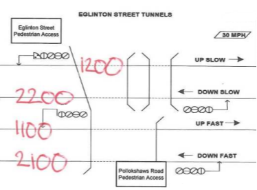
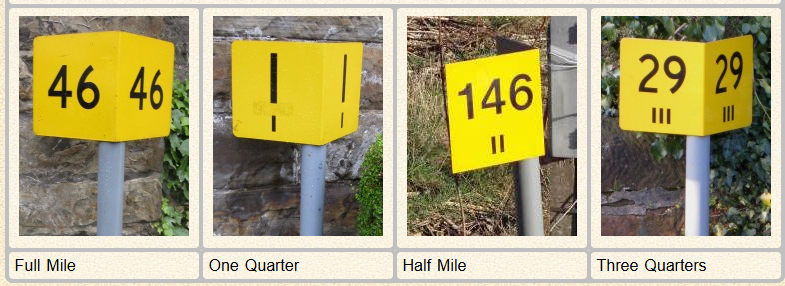
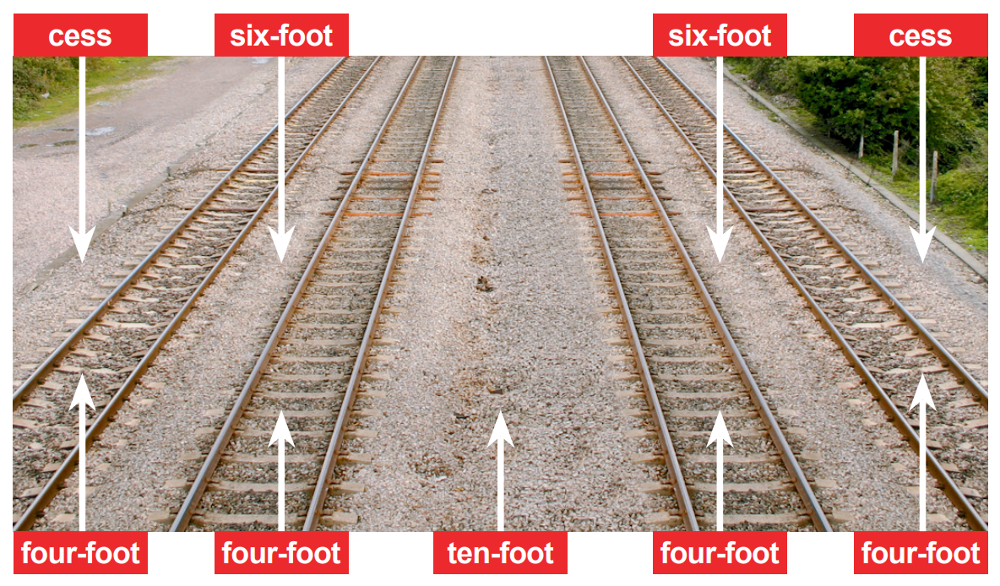
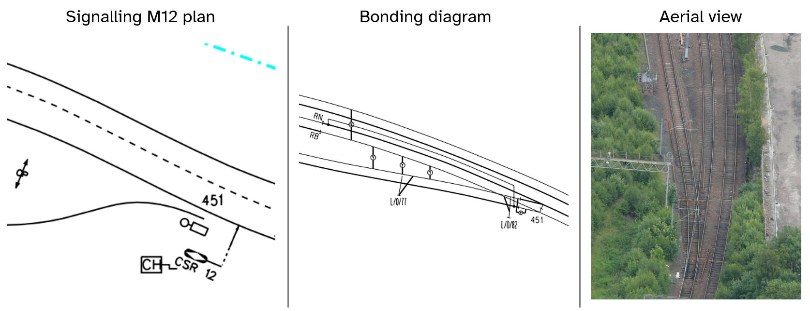
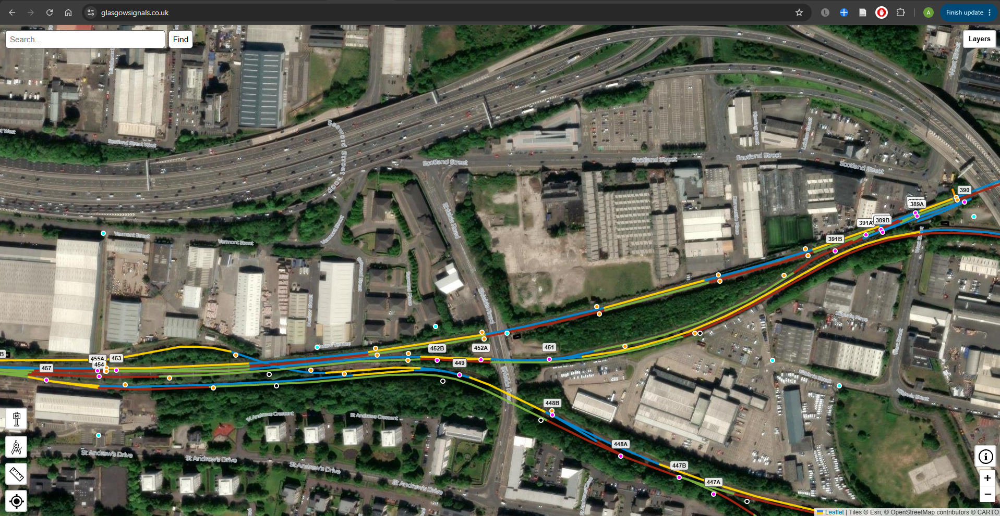
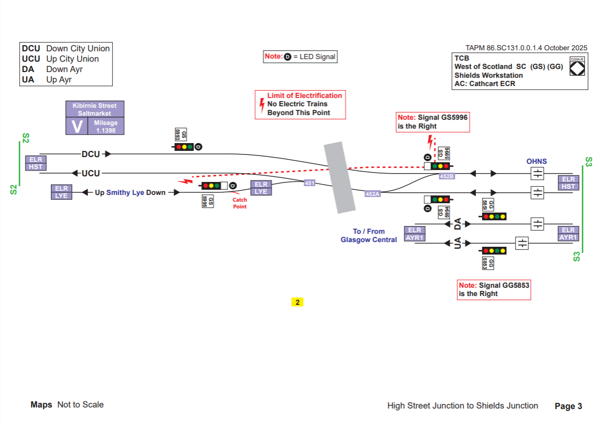
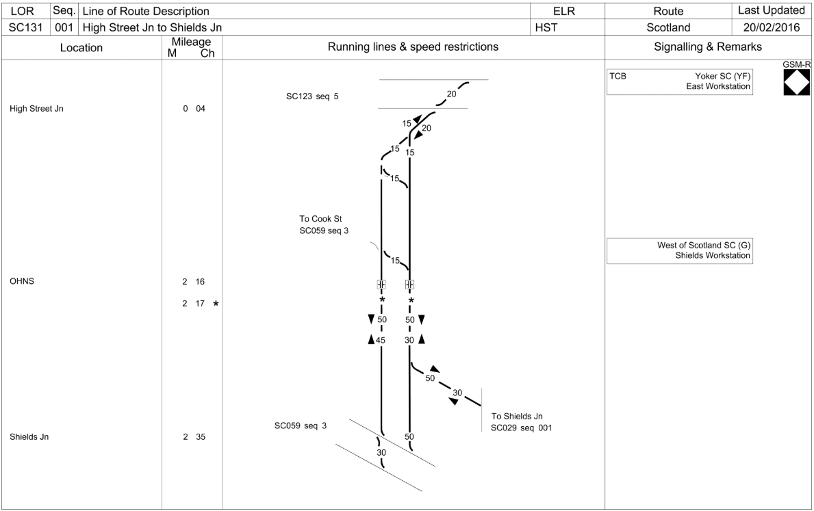

# Railway basics

::: {.callout-note title="Learning objectives"}
Understand common terminology used to refer to trackside locations, understand directional terminology on the railway, and how to identify locations.
:::

## Responsibilities

Railway lines are formed of two running rails and sleepers between them. There are also various other components that you will see around the railway, some of which will belong to other departments. The track department, more commonly known as p-way, is responsible for looking after the track itself. This includes the rails, the sleepers, and the ballast.

::: background
The name "p-way" comes from the term "Permanent Way", which was used to describe the final railway that was constructed. In the early days of railway building a "Temporary Way" was first quickly constructed to help get materials to site.
:::

Almost all of the railway surrounding Glasgow is now electrified using overhead lines. There are therefore overhead gantries and stanchions dotted around to suspend the overhead lines from. The Overhead line department are responsible for looking after these, although the power is maintained by the Electrification and Plant (E&P) department. E&P are also responsible for switch heaters that run along the rails of points to keep them clear of snow and ice, and the compressed air which drives many of the points in Glasgow Central.

Off-track look after all the things which are not directly part of the railway, but are needed to keep it safe and secure. This includes fencing and vegetation. You might need to speak with them a lot in the summer months when trees begin to grow and obscure signals.

The Telecoms department are responsible for all the telecoms that is used by the railway. In years gone by this was part of the signalling department's job, which is why we're known as S&T, although now we do very little telecoms. The only telecoms we are still responsible for are signal post telephones (SPTs).

## Tracks and lines

A **track** normally consists of two running rails and the structure that supports them. A **single-track** railway has one track; a **double-track** railway has two. A railway with four tracks has eight running rails. Points connect tracks so that trains can pass from one to another.

The word **line** often means a particular track, as in *Up Main line*. It can also describe a railway between places, so someone might say the Neilston line, but actually mean both the *Up Neilston* and the *Down Neilston* as they're referring to the branch as a whole. A bit of context is often needed to know exactly which is being referred to.

## Up and Down directions

**Up** and **Down** are established railway directions. They provide a consistent way to describe movements and distinguish tracks without relying on the direction in which someone happens to be looking. Up commonly means towards the principal station on that route, often the headquarters of the company which built that line. Many lines use London as the marker for the Up direction, but some lines in the area use Glasgow instead. This is just something that you will have to learn as you get to know the section.

Most lines will have one predominant direction of movement, so will be known as the Up or Down line. For example, the *Up Fast* mostly carries trains in the Up direction, towards London. Some bits of it are bi-directionally signalled however, so trains can travel in either direction. This means it is possible for a train to be travelling in the Down direction (towards Glasgow) on the *Up Fast*.

Where there is a single-track section of railway these are normally bi-directionally signalled so that trains can travel in either direction. They will still have an Up and a Down direction though.

## Line names

Fast and Slow are common line names, although in some regions the terms Main and Relief are more commonly used, with the same meanings. Fast lines are generally intended for faster or non-stopping services, with Slow lines more commonly associated with stopping passenger services or freight trains. Fast lines might have a higher maximum permissible speed than Slow lines, but this isn't always the case. Often the line speed might actually be the same for both lines.

Lines may also have other designations, which might refer to geographical locations (e.g. Gourock or Hertford), usage (e.g. Suburban or Departure), or be named for historical reasons (e.g. City Union or Smithy Lye).  These designations are not necessarily an indication of how a line is used today, and their meaning may have been all but forgotten.

## ELRs, Track IDs, and mileages

Every location on the railway has an ELR, Track ID, and mileage. With these three pieces of information every location on the railway can be identified exactly.

### Engineer's Line Reference

Each route on the railway is given an Engineer's Line Reference (ELR). This a three letter code, which sometimes also has a number. ELRs were generally chosen wherever possible to relate to the line that they referred to, but as each line needed a unique ELR this wasn't always possible.

A number is used at the end of the ELR when there is a discontinuity in mileage along a route. This might happen if the track layout has changed over the years or the original measurements were very inaccurate.

The ELRs within the Glasgow Central section are given in the table below. Origins of the ELR are given where they aren't obvious to help remember them.

| ELR | Line | Name Origin |
|-----------------|-----------------|---------------------------------------|
| ARG1 & ARG2 | Argyle line |  |
| AYR1 | Ayr line |  |
| BRD | Through Terminus | This line is also known as the **B**urma **R**oa**d** |
| CLY | Clydesdale line |  |
| CNC | Cathcart North Curve |  |
| CND1 & 2 | Deanside branch | The line branches off at **C**ardo**n**al**d** |
| CNL | Corkerhill and Paisley Canal line |  |
| CTC | Cathcart Circle |  |
| EKE | East Kilbride line |  |
| GBK | Barrhead line | Originally built by the **G**lasgow, **B**arrhead and **K**ilmarnock Joint Railway |
| HST | City Union line | Line joins Shields Junction and **H**igh **St**reet |
| KHL | Kirkhill line |  |
| LFS | Larkfield Curve | Originally known as the **L**ark**f**ield **S**outh Curve |
| LYE | Smithy Lye |  |
| MEN1 & MEN2 | Muirhouse line | Probably named as the line is from **M**uirhouse Junction to **E**glinto**n** Junction |
| RCB | Carmyle line | Originally known as the **R**utherglen and **C**armyle **B**ranch |
| RNC | Rutherglen West Curve | May have once been known as the **R**utherglen **N**orth **C**urve |
| TSS | Terminus Curve | Originally known as the **T**erminu**s** **S**outh Curve |
| WCM2 | West Coast Mainline |  |

### Track ID

Each line also has a Track ID, which is a four digit code which describes the type of line and the direction of travel.

Track IDs aren't used often by S&T, so it isn't strictly necessary to memorise them all but they can be helpful when talking to other departments which use them more often, such as pway.

The numbers are always in the form of DNXX where:

| D | N | XX |
|------------------|----------------------------|---------------------------|
| 1 - Up | 1 - Main or Fast (or other line performing this function) | 00 - the first line at this location with that direction and type |
| 2 - Down | 2 - Relief, Slow, or Through (or other line performing this function) | 01 - the second line at this location with that direction and type |
| 3 - Bi-directional | 3 - Goods | 02 - the third line at this location with that direction and type |
| 4 - Merry-go-round loop | 4 - Single line | ...and so on... |
|  | 5 - Loop |  |
|  | 6 - Terminal track or Bay |  |
|  | 7 - Crossover |  |
|  | 8 - Other |  |
|  | 9 - Siding |  |

Using the below diagram from Glasgow Central as an example we have:

- 1200 - Up Slow

- 2200 - Down Slow

- 1100 - Up Fast

- 2100 - Down Fast

{fig-align="center" width="635"}

### Mileage

All lines also have a mileage, starting from a datum point. The origin points are normally the destination of the Up line, but there are some exceptions.

::: trivia
In Scotland mileages are usually given in Miles and Yards, but in the rest of the UK mileages are given in Miles and Chain. You might still see chain used in some documents, such as the Sectional Appendix, so it's important to be be able to convert between the two.

A Chain is an old measurement equal to 22 yards (or roughly 20 metres).

1 mile = 80 chain = 1760 yards

3/4 mile = 60 chain = 1320 yards

1/2 mile = 40 chain = 880 yards

1/4 mile = 20 chain = 440 yards
:::

Mileposts are used to mark every quarter of a mile (although they are sometimes missing, or hidden). The large number is the mile, and the bars or dots underneath indicate quarters of a mile.

{fig-align="center"}

The diagram below of Busby Junction shows how a location can be narrowed down first by ELR, then by Track ID, and then by mileage. Alternatively, just the ELR and mileage could be used to identify a place but not necessarily a track, or a line name could be used. For this example it would be just as valid to say 0m 103yds on the *Up East Kilbride*.

{fig-align="center"}

## The spaces around the track

The following names describe where something lies relative to the rails:

| Term | Meaning |
|------------------------|-----------------------------------------------|
| **Four-foot** | The space between the running rails of one track |
| **Six-foot** | The space between adjacent tracks in the usual double-track description |
| **Ten-foot** | The wider space between pairs of tracks in a four-track arrangement |
| **Cess** | The area alongside the outside of the running lines |

These names identify spaces rather than certifying their dimensions, for example, *four-foot* is not the measurement used to specify track gauge. The [Trackwork](trackwork.qmd) chapter explains gauge and the construction of the track.

You may also hear the 10-ft called a "wideway".

::: callout-important
Spaces may be smaller than their names suggest. Do not rely on the names to judge whether you are in a position of safety.
:::

## How tracks appear on plans

A signalling scheme M12 plan generally represents each track by **one line**. That line stands for the complete track, not an individual rail. A double-track railway therefore appears as two lines even though it has four running rails. A detailed bonding diagram, by contrast, generally shows both rails as the individual connections between the rails matter.

M12 diagrams are the most common diagram that you will come across. They show almost all signalling equipment, but can be confusing at first due to the number of symbols used. The above diagram contains the symbol for a point machine (the connected circle and rectangle).

::: callout-tip
Start by finding the orientation of a plan, using line names, stations, points, signals, or other features that are shown. It will become easier to relate what you see on the plan to what you see on the ground as you become more familiar with both the plans and the location.
:::

It's important to understand what is shown on each type of diagram so that you can relate it to the real world conditions on the ground.

M12 signalling plans and bonding diagrams are generally to scale, but the scale may change throughout the plan depending on the complexity of the layout. Do not assume that just because two things look close together on the plan they will be a short walk in real life!

There is also an [unofficial website](www.glasgowsignals.co.uk) \[password: Glasg0w!\] covering Glasgow showing the locations of all the assets and track circuits which can be useful when working out distances or finding assets. It's vital to be able to understand official diagrams but this can be useful resource to assist you in getting to know the area.

{fig-align="center"}

## Other diagrams

Another diagram you may come across are TAP diagrams. These can be found on the [Scotland's Railway Planning Hub](https://networkrail.sharepoint.com/sites/ScotlandsRailwayPlanningHub/SitePages/Home.aspx). They can be a bit more user friendly, but aren't used that often as they don't give as much detail as an M12.

{fig-align="center"}

The Sectional Appendix is a document produced that gives all sorts of information about each line, which is mostly relevant to train drivers. It does, however, include diagrams which contain some important information, such as line speeds and controlling signal box. The relevant extracts of the Sectional Appendix will always be included in your safe work pack and can also be found [online](https://www.networkrail.co.uk/industry-and-commercial/information-for-operators/national-electronic-sectional-appendix/).

