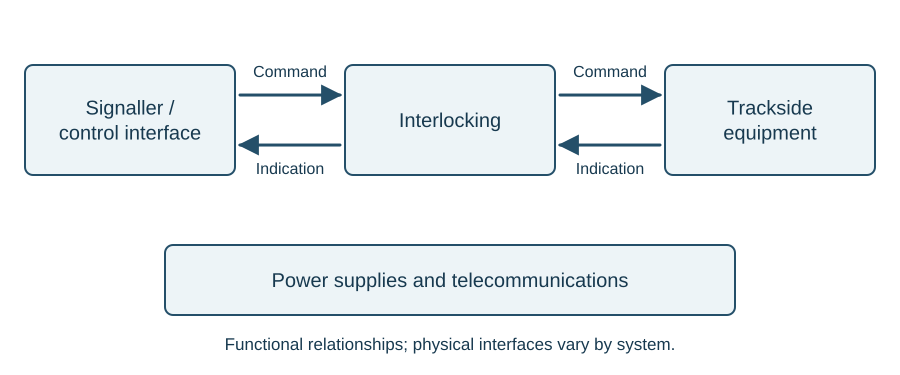

# Railway signalling

::: {.callout-note title="Learning objectives"}
Explain the need for train separation; distinguish block working from interlocking; identify the main parts of a signalling system; follow command, action and indication; and explain the roles of power, communications and fail-safe design.
:::

## Safety and the service

The principal purpose of signalling is to organise movements so that trains do not collide. That includes a following train catching a train ahead, opposing trains meeting on the same line, and trains converging at a junction. Signalling also influences the service that can be operated. A railway carrying occasional trains has different capacity requirements from one carrying trains a few minutes apart.

These purposes are connected. Shortening the interval between trains requires a suitable method of separation and adequate warning for braking. Adding signals without considering braking, detection and route locking does not automatically create a useful increase in capacity.

## The system as a whole

A railway moves vehicles along a guided path. A train cannot steer round an obstruction and may need a substantial distance to stop. Signalling organises movements so that the required route and separation are established before the train proceeds.

Track provides the path, points select it, train detection reports occupation, and the interlocking determines when a movement may be authorised. Signals communicate the permitted movement to the driver. Power supplies and telecommunications support those functions.

A useful first drawing separates the **control device**, **interlocking** and **railway equipment**. Commands travel towards the equipment; indications return information about its state.

{#fig-system-overview}

The arrows are functional relationships, not a statement that every installation uses a separate cable for each arrow. Relay interlockings and SSI implement the relationships differently.

## Why time alone is insufficient

A time-interval system releases a second train a specified time after the first. Its weakness is simple: the first train may have stopped. Elapsed time cannot prove that the line ahead is clear. Time-interval working was used on some early railways before rapid communication between controlling locations became available.

A space-interval system instead separates trains by defined sections. The key question becomes whether the preceding train has left the protected section as once this can be proved it becomes much easier to keep trains apart. This is the foundation of block working.

## Absolute block

In a simple example, adjacent signal boxes A and B communicate using bells and block instruments. The receiving signaller controls indications associated with the section. The three indications are **Line Blocked**, **Line Clear** and **Train on Line**.

At a conceptual level, the receiving box agrees to accept a train, the sending box signals it forward under the required conditions, and the instruments record its entry into the section. The receiving box establishes that the train has arrived complete before the section is made available again. Arrival of the locomotive alone is insufficient: vehicles could have become detached and remain in the section.

This explanation identifies the safety purpose of the communications. It is not a bell-code sequence or an instruction for operating block instruments.

::: {.callout-important title="Two different protections"}
Block working organises the separation of trains along a line. Interlocking prevents incompatible settings and movements within its designed scope. A junction can be correctly set while the line ahead is occupied; an empty line does not prove that a junction is correctly set.
:::

## Electrical operation and control

A point machine provides the force at the points, while electrical detection reports the required resulting conditions. Relay circuits or electronic interlockings enforce the movement constraints, allowing the control interface and the equipment implementing the safety logic to have different physical forms. The operator's command, the equipment action and the resulting indication are separate parts of the system.

## Command, action and indication

Follow the **command**, **action** and **indication** separately. The command tells the equipment what to do; the action is what the equipment does; the indication reports its state. A command can be registered without the equipment completing its movement, so an indication must be understood through the equipment and circuit arrangement.

The signaller uses a control panel or workstation to enter commands and view indications. A track layout and equipment indications may share the same screen, but their physical combination does not make their engineering functions identical.

The interlocking checks the designed conditions and controls the railway equipment accordingly. It receives information such as point detection, train-detection states and signal proving. The signaller's command passes through this logic before it can result in a permitted movement.

## Track circuit block and automatic signals

A track circuit uses the rails as part of an electrical circuit to establish whether a defined section is clear. It gives the signalling system information that does not depend on the signaller remembering the position of every train.

With continuous train detection and suitable controls, a plain-line signal can respond automatically to conditions ahead. In track circuit block, train detection supports the separation of trains between signals. **Automatic** describes how a signal is controlled; it does not mean that it operates without safety conditions.

The signal aspects must give the driver the required warning of a stop indication. The lineside signals chapter connects that requirement to braking distance, overlaps and headway.

## From individual controls to route setting

With individual controls, the signaller sets the points and then operates the signal control. An entrance-exit (NX) interface lets the signaller identify the start and end of the required movement. The system calls the required points and establishes the route conditions.

The route command does not override the interlocking. If a required point is not detected, a track section is occupied or a conflicting route remains locked, the commanded proceed aspect cannot be obtained under those conditions.

Remote control makes it possible to operate geographically separated interlockings from a signalling centre without providing a separate long-distance wire for every control and indication. The interlocking and remote control system perform different jobs, a distinction developed later in the course.

## Follow a movement through the system

Imagine a train waiting at a signal before a junction. The signaller wants it to take the branch. Several distinct events must occur:

1. The signaller enters a route command.
2. The interlocking checks the conditions associated with that route.
3. Points are called to the required positions where movement is permitted.
4. Detection reports the positions and locking conditions required by the design.
5. The interlocking establishes that the necessary conditions are proved and that conflicting movements are excluded.
6. The signal can display the permitted aspect.
7. Train detection reports the train's progress, supporting the designed release of the route.

This sequence is simplified. Each stage depends on the actual equipment and controls: registering the command, supplying the operating energy, completing the action and obtaining the relevant indications are separate events.

## Fail-safe behaviour

A **right-side failure** produces a more restrictive result than the traffic conditions require. For example, loss of a track-clear proving circuit may prevent a signal clearing even though the track is physically empty. A **wrong-side failure** produces a less restrictive result than the conditions justify, such as an occupied section being indicated clear to the safety logic.

Fail-safe design aims to prevent specified faults from producing unsafe permissions. It does not mean that equipment cannot fail, nor that every possible failure automatically lights a red lamp. A failed power supply can leave a signal dark. The safety arrangement must address the loss of the required information or indication as part of the design and operating system.

::: {.callout-important title="Think in terms of permission"}
The central question is whether the failure can allow a movement that should be prevented. "A fault has occurred" does not by itself tell you whether its effect is right-side or wrong-side.
:::

## Power is a separate engineering path

The logic deciding that points may move does not supply the mechanical energy needed to move them. Similarly, a command for a signal aspect does not itself supply the lamp's energy. Power supplies, distribution cables, transformers, rectifiers and local protection support the control system.

A signalling-centre power cubicle provides supplies at the required voltages, trackside distribution and standby arrangements. One arrangement uses 650 V distribution to trackside equipment, with local conversion to the required working supplies. Individual circuits in a location case operate at their specified voltages.

A common supply can affect several apparently unrelated items. When several indications disappear together, their shared power or communications path is a relevant system relationship to examine in the drawings.

## Cable routes and equipment housings

Cables follow a planned route, often in troughing. Undertrack crossings carry routes between sides of the railway. The route protects and organises cables; it also brings the signalling system into contact with civil-engineering work, drainage and the track environment.

A **location case**, often called a **loc**, houses interfaces close to the equipment. It can contain terminals, relays, track-circuit apparatus, local supplies and other equipment appropriate to the installation. Short connections from a housing to the signal, point equipment or rails are commonly called **tail cables**.

An equipment room provides more space where a group of cases would be unsuitable. The important relationship is the same: equipment housings provide the interface between the wider scheme and local railway assets.

## Automatic route setting and telecommunications

Automatic route setting can add a further layer of commands using timetable and train information. The commands remain subject to interlocking conditions.

Telecommunications provides both human communications and data paths. Signal post telephones, point-area telephones and radio are examples. A transmission network can also carry remote control and other operational information. The service being carried and the physical bearer carrying it should be considered separately.

## Train describers: background {#sec-train-describers}

A **train describer** associates a service identity with a displayed position, or berth, and uses train-detection and route information to step the description as the train moves. Its information can also support passenger displays and other operational systems. It identifies the service associated with a position; it does not prove the track clear or replace the interlocking's safety checks. A wrong description can therefore cause confusion or misrouting even when the interlocking continues to prevent conflicting movements.

## Automatic Warning System

The Automatic Warning System (AWS) provides an audible indication in the cab. A warning requires acknowledgement by the driver; if it is not acknowledged, the system initiates a brake application.

AWS supports the driver by drawing attention to a warning. It works alongside the signals and the driver's knowledge of the route.

## Other interfaces

Level crossings and the Automatic Warning System (AWS) connect signalling with other parts of the railway. Each has a different purpose:

| Interface | Main purpose |
|---|---|
| Level crossing equipment | Manage the interface between road and rail movements |
| AWS | Provide an in-cab warning or clear indication associated with an approach |

These interfaces are introduced here to explain their place in the signalling system. Equipment-specific chapters can develop their operation in more detail.

## Activity: two trains at a junction

Train A is standing beyond a junction. Train B is approaching a signal before it. The points are correctly set for B's intended route. Explain why that fact alone cannot justify clearing B's signal.

::: {.callout-note collapse="true" title="Suggested reasoning"}
Correct point position establishes only one condition. The line to be used must also satisfy the train-detection and separation requirements, the required overlap and protection must be available, and conflicting movements must be excluded. A train standing beyond the junction may prevent these conditions being met.
:::

## Worked example: one symptom, several paths

A display shows that a branch route command has been registered and the points have been commanded reverse, but the entry signal remains at danger. Someone concludes that the signal must have failed because the command went through.

Registration of the command does not establish that the points moved, the required detection was obtained or every signal control condition was satisfied. Follow the system relationships:

1. **Command:** was the intended route or point command registered?
2. **Energy:** was the required supply available to the equipment?
3. **Action and indication:** did the equipment move and lock, and was the required detection indication obtained?
4. **Signal controls:** were all other conditions for clearing the signal satisfied?

A signal remaining at danger may be the correct response to a missing indication elsewhere. This example organises the evidence; it does not prescribe an order for intrusive tests or identify a failed component from the final symptom alone.

## Key points

- Time elapsed does not prove that a train has cleared a section.
- Block working and interlocking address related but distinct problems.
- Route setting simplifies entering commands; the interlocking still governs the result.
- AWS draws attention to a warning and requires the driver to acknowledge it.
- Command, action and indication are distinct parts of the equipment sequence.
- A registered command does not establish that every subsequent stage has completed.
- The interlocking separates the movement command from the permission to act.
- Power, communications and physical railway equipment are all part of the scheme.
- Failure classification depends on the safety consequence.
- An interface drawing is a useful starting point for understanding a whole installation.
