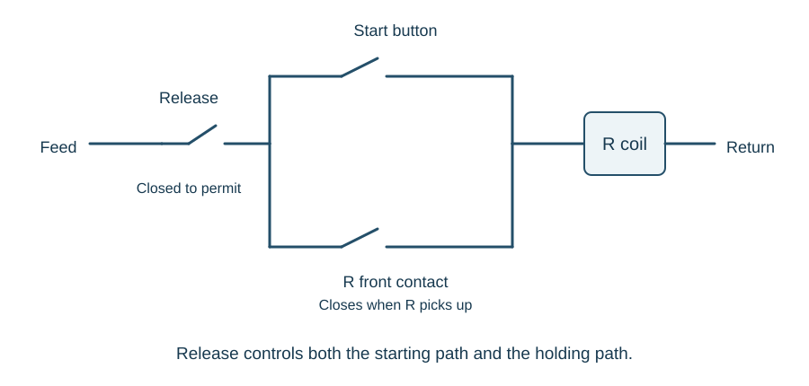

# Relays and relay logic

::: {.callout-note title="Learning objectives"}
Explain relay construction and front/back contacts; distinguish neutral, biased, polar, latched, twin, timed and vane arrangements; interpret independent and dependent contacts; locate a relay through its records; translate logic into contact paths; and distinguish electrical holding from magnetic retention.
:::

## A switch operated by an electromagnet

A relay combines a coil, a magnetic circuit, a moving armature and electrical contacts. Coil current produces a magnetic force that moves the armature. The movement operates several contacts, allowing one circuit to influence other circuits without directly joining all their electrical supplies.

A relay is **energised** when its coil is supplied as required, and **de-energised** when it is not. In the ordinary neutral-relay example, it **picks up** when energised and **drops away** when the supply is removed. Special relays can have different behaviour, so the type matters.

The contact state is defined relative to the relay's operated state:

| Relay state in the basic example | Front contact | Back contact |
|---|---|---|
| Down | Open | Closed |
| Up | Closed | Open |

The words front and back avoid the ambiguity of saying "normally open" when a relay may normally be kept energised in service. A track relay, for example, can be energised throughout the time its section is clear.

## Independent and dependent contacts

An **independent contact** has its own arm connection and associated fixed contact. A **dependent contact arrangement** uses a common arm that transfers between two fixed contacts. In the basic neutral example, these are the front and back contacts. The common terminal is shared, so the two paths must not be read as isolated switches.

Terminal notation depends on the relay construction. Some arrangements identify the finger and its arm, front and back connections; miniature plugboards use their specified letter-and-number positions. Translate the symbol through the applicable terminal information rather than transferring a familiar numbering rule to a different relay.

Contact behaviour during movement also matters. A specified **bridging contact** makes both paths during part of its travel. This is a particular characteristic, not something to assume for every changeover contact. Similarly, two breaks within one contact arrangement describe its physical interruption; they do not by themselves establish the separate feed-and-return control of a double-cut circuit.

## Inside a miniature signalling relay

The coil is wound around a soft-iron core. The core, yoke and armature provide a magnetic path. Soft iron carries the flux readily but retains relatively little magnetism after the coil current is removed. The armature pivots towards the pole face and operates a drive bar, transferring movement to the contact arms.

| Part | Contribution to operation |
|---|---|
| Coil and core | Convert coil current into magnetic flux |
| Yoke | Complete much of the magnetic path |
| Armature and pivot | Turn magnetic attraction into mechanical movement |
| Drive bar | Operate the contact arms |
| Buffer bar | Limit the contact movement and support the intended contact pressure |
| Residual pin | Maintain a small non-magnetic gap at the attracted position |
| Case and baseplate | Support and protect the assembly |

The **residual pin** prevents full metal-to-metal closure of the magnetic path. The resulting gap helps ensure that residual magnetism does not hold the armature attracted when the supply is removed. It has a different purpose from the contact buffer and from any return spring.

Contact materials are selected for the required resistance, current duty and resistance to welding. A miniature signalling relay can use silver and silver-impregnated graphite at its contact surfaces. Mechanical clearance, pressure and material choice are part of the complete relay design; a contact is more than an ideal switch drawn on paper.

For a neutral d.c. relay, reversing the coil current reverses the magnetic poles but still attracts the armature. A biased relay deliberately adds a directional characteristic. This distinction explains why observing an apparently correct voltage magnitude is insufficient without understanding the relay type and polarity.

## Plugboards, wiring and equipment identity

The relay's spring connections engage the plugboard connections. Wires terminate in spade connectors retained in the plugboard, with identification beads linking the physical wires to their circuit records. Retaining arrangements secure the relay in position, while seals protect the internal assembly against unauthorised disturbance.

A connection can be electrically specified on a circuit sheet but physically located through a rack or location profile. A typical profile records the function, position, relay specification, coding and contact arrangement. The profile's stated viewing direction matters: a front-view arrangement cannot be transferred directly to a rear view without accounting for the change of perspective.

The number of wires accommodated by a connector is limited. Where several points must be joined, a designed chain of connections can distribute the common path instead of crowding all wires into one terminal. A drawn branching path therefore has a physical termination arrangement behind it.

A replacement relay must match the specified function and characteristics, including its voltage, timing, contact arrangement and coding. Pin coding is a safeguard against incorrect substitution; it is not a substitute for checking the label, records and physical condition.

## Types and construction

The BR miniature relay family includes several special functions:

- A **neutral relay** provides the basic electromagnetic switching function.
- A **biased relay** is designed to respond to the intended current direction.
- An **a.c.-immune relay** is designed to operate on its specified d.c. supply without responding to the specified a.c. interference.
- A **contactor** has contacts suited to heavier loads, such as point-machine control.
- A **slow-pick relay** delays the operation of its contacts after energisation.
- A **slow-release relay** delays contact release after removal of coil current.
- A **latched relay** retains its operated state until the required release action.

## Special relay behaviour

### Double-wound and twin relays

A **double-wound relay** has two electrically separate windings acting on one mechanism. Either winding can operate the common contact assembly in the intended arrangement. The coil circuits are separate, but the resulting mechanical state is shared.

A **twin relay** contains two independent relay mechanisms in one housing, each serving its own function and contacts. It saves space where each function needs fewer contacts. Two coils visible in a case therefore do not, by themselves, tell you whether the device is double-wound or twin.

### Immunity and timing

A copper sleeve or slug on the magnetic circuit opposes rapid changes of flux. Its position and the associated magnetic arrangement can create the required immunity or delay characteristics. An a.c.-immune d.c. relay is designed not to respond to the specified alternating interference; the characteristic has to match the electrical environment.

Slow pick and slow release delay different transitions. A track repeater can require a sustained clear input before picking. A lamp-proving relay can bridge the brief interruption of current during an intended change of aspect. Neither delay should be assumed from the relay's external shape or from a generic delay quoted for another type.

Dedicated timing functions can use different mechanisms:

| Timer | Principle |
|---|---|
| Synchronous motor | A motor and gearing move through a defined travel before operating contacts |
| Thermal | Heating and cooling of an element provide a controlled contact sequence |
| Electronic | A defined electronic timing process controls the output function |

The timing interval may include more than the first visible movement. In a thermal arrangement, the warm-up phase can start a sequence whose final output follows the cooling phase. Read the complete circuit before deciding when the timed function should occur.

### Magnetic memory and electrical memory

A **magnetically latched relay** can retain its contact state without continuous coil current. A separate operation releases or changes it. The polar-stick example in the next subsection uses a particular form of this retention.

This differs from the electrical stick circuit described later in this chapter. An ordinary relay in an electrical stick circuit needs continuing energy through its holding path. Magnetic retention can preserve a state through a loss of supply, so the expression "no coil current means all relays are down" is unsafe as a general rule.

### Two-position and three-position polar relays

A polar relay uses current direction to select normal or reverse. The table compares a retaining two-position arrangement with a three-position arrangement that has a centre state. The polarity-to-terminal relationship comes from the relay and circuit information.

| Input condition in the teaching comparison | Retaining two-position polar relay | Three-position polar relay |
|---|---|---|
| Specified normal polarity | Normal | Normal |
| Specified reverse polarity | Reverse | Reverse |
| No coil input | Last selected position retained | Centre; neither outer contact made |

Thus an unpowered polar relay cannot be interpreted from the word *polar* alone. The number of positions and the specified retention characteristic determine what its contacts can do.

### Contactors and vane relays

A contactor uses contacts and interruption arrangements suited to a heavier load. Magnetic blow-out helps control an arc when a loaded contact opens. A contact suitable for an indication circuit cannot automatically interrupt a point-motor load merely because both are drawn as contacts.

An **a.c. vane relay** works differently from the neutral d.c. relay. Local and control magnetic systems act on a conducting vane. Their currents must have the intended frequency and phase relationship to produce the operating torque. In the double-element arrangement, loss of either required input removes that torque.

This gives a useful link to the [train-detection chapter](train-detection.qmd): the receiver must recognise the intended electrical evidence, rather than simply respond to any current present at the rails.

## Worked example: two coils, two possible meanings

A drawing shows two coil pairs associated with a single housing. One learner assumes that the two functions have independent contacts. Explain what must be checked.

A double-wound relay has two windings operating the same mechanism; a twin relay has two mechanisms. The specification, naming, connection information and profile establish which arrangement is present. Counting coils or cases is insufficient to identify the logical independence of the functions.

## From a contact to a complete path

Use the [circuit-reading method](circuit-reading.qmd) to establish supplies, terminals and sheet references before translating contacts into logic. The examples below assume that the required feed and return are available, so they can concentrate on the relationships between relay states.

## AND and OR

For an ideal teaching circuit, assume a suitable supply and no faults. To energise relay R when A **and** B are up, place front contacts of A and B in series. Both contacts must close to complete the path.

To energise R when A **or** B is up, place the front contacts in parallel. Either path can complete the circuit. OR is inclusive: both may be up.

| A up | B up | R for A AND B | R for A OR B |
|---|---|---|---|
| No | No | Down | Down |
| No | Yes | Down | Up |
| Yes | No | Down | Up |
| Yes | Yes | Up | Up |

A back contact introduces a condition involving the relay being down. For example, an A front contact in series with a B back contact expresses **A up AND B down**.

Be precise about "only when" and "whenever". Saying that R may be up only when A is up makes A a necessary condition. It does not, by itself, say that A being up is sufficient: the circuit might contain other conditions. When drawing a complete truth table, state that the listed inputs fully define the teaching circuit.

## Reading a compound requirement

Suppose the full energisation requirement is:

**R up = A up AND (B up OR C up).**

A front contact is placed in series with a parallel pair of B and C front contacts. If A drops, neither branch can energise R. If A is up, either B or C can provide the remaining path.

The complementary statement is that R is down if A is down, **or** if both B and C are down. Changing from energisation conditions to de-energisation conditions changes AND and OR relationships. Checking the four or eight possible input combinations is often clearer than trying to interpret a long sentence mentally.

## Memory: the stick circuit

A momentary push button can energise a relay, but releasing the button opens that path. A **stick circuit** places a front contact of R in parallel with the starting button. Once R has picked, its own contact provides a holding path.

{#fig-stick-circuit}

The circuit also needs a way to release R. A release condition in series with both paths removes the holding current when required. Placing the release condition only in the push-button branch would leave the stick branch able to hold R.

This is electrical memory rather than a latched relay mechanism. In the basic example, loss of the supply drops R and opens its stick contact. Restoring the supply alone does not restart it when the starting button is open.

## Finding a named relay

The [function-name table](circuit-reading.qmd#sec-function-names) explains the naming convention. Once a name has been interpreted, use the profile and relay specification to establish its physical position, contact arrangement and characteristics. Knowing what a name means does not establish which plugboard position or terminal is required.

## Relays controlling aspects

Aspect selection applies the same logic to a visible railway function: the less restrictive aspect requires its positive conditions. Control state, lamp supply and the lamp-proving indication remain separate. The [lineside-signals chapter](lineside-signals.qmd) brings those functions together, including aspect-control relays and lamp proving.

## Worked example: the missing release

R starts through a button and holds through its own front contact. A track-clear contact is fitted only in the button branch. Once R is up, the track-clear contact opens, but R stays up. Explain the result.

The holding branch bypasses the track-clear contact. The circuit therefore checks that condition when starting but does not require it while holding. If the requirement is for loss of the track-clear indication to release R, the condition must control the holding path as well. A real safety circuit needs its complete design and failure analysis, beyond this ideal example.

## Key points

- The magnetic circuit, residual gap and contact mechanism contribute to the relay's behaviour.
- Double-wound and twin describe different relationships between coils and mechanisms.
- Front and back identify contact states relative to relay operation.
- Series paths express AND; parallel alternatives express OR for energisation.
- A stick circuit changes the path available after the relay operates.
- Function names connect contacts to their coils and equipment.
- An ideal logic diagram alone is not a complete safety design.
