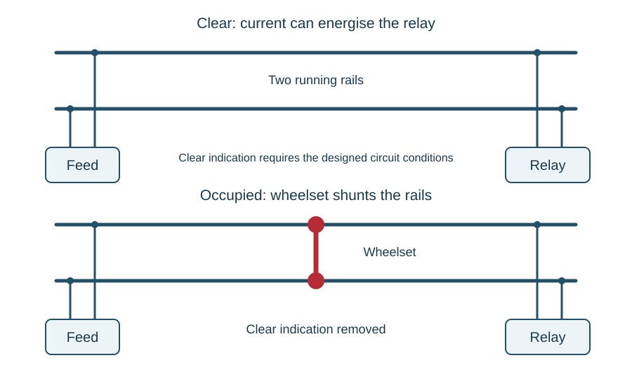
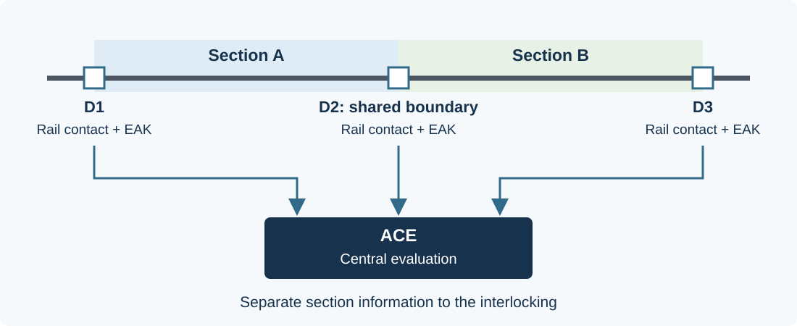

# Train detection

::: {.callout-note title="Learning objectives"}
Explain track-circuit feed and receiver functions; relate shunting, ballast leakage and drop-shunt sensitivity; distinguish bonding and rail arrangements; explain clearance boundaries, insulation faults, the traction-return interface and interrupters; and compare track circuits with axle counters; and identify the detection, communication and evaluation stages of AZLM equipment.
:::

## What must be established?

Train detection establishes whether a defined section is clear or occupied for signalling purposes. It must deal with stationary vehicles as well as moving trains. Its boundaries and identity must be clear in the design and on the relevant plans.

A track circuit uses the running rails as part of an electrical circuit. An axle counter establishes the occupation state from the counted passage of axles at detection points. Both provide an input to signalling logic, but they obtain their evidence differently.

## The basic track circuit

A simple d.c. track circuit has a feed connected across the rails at one end and a track relay across them at the other. With no vehicle present, current flows along one rail, through the relay and back along the other rail. The relay can remain energised.

A conducting wheelset connects the rails with a relatively low resistance. This **shunts** the track circuit, reducing the energy available to the relay so that it drops away. In the basic arrangement, relay up represents the proved-clear state; relay down means that clear is not proved.

{#fig-track-circuit}

Consider a broken connection or loss of feed. Either removes energy from the relay and removes the clear indication. If the opposite convention were used, with an unenergised relay interpreted as clear, loss of supply could falsely report clear while a train was present. The choice of energisation convention is therefore part of the safety principle.

This does not prove that every fault in every track circuit is safe. Unintended feeds, inadequate shunting, failed insulation and equipment faults must also be addressed by the complete design and maintenance arrangements.

## Real rails are not an ideal circuit

Current can leak between rails through sleepers, fastenings and ballast. **Ballast resistance** describes this distributed leakage path. Wet or contaminated conditions can increase leakage and reduce the energy reaching the receiver.

The wheel-rail shunt is also imperfect. Contamination, surface films and vehicle conditions can affect contact. A track circuit must distinguish the required clear and occupied states across its specified operating conditions, rather than merely work on a clean demonstration track.

Feed resistance, rail resistance, cable lengths, ballast leakage and receiver characteristics all influence the result. This is why limits and settings are equipment-specific. Increasing a supply to overcome one symptom can compromise another required condition; this book does not provide adjustment instructions.

## Feed regulation and the shunting margin

A basic d.c. arrangement includes a **feed or regulating resistance** in the supply path. It limits current when a wheelset shunts the rails and forms part of the electrical balance between the supply, rails, ballast and relay. The resistor may be separate or incorporated in the feed unit.

With the section clear, part of the feed current leaks through the ballast and part reaches the relay. Lower ballast resistance increases that leakage and can reduce the relay input sufficiently to remove the clear indication. The feed setting must preserve the required margins across the specified ballast conditions.

The relay's **pick-up** and **drop-away** characteristics define different transitions. Sufficient input is needed to pick the relay, while the input must fall sufficiently to release it. The required margin has to cover both an unoccupied section and an effective train shunt across the range of specified conditions.

### What drop shunt means

The **drop-shunt value** is the shunt resistance, applied at the specified test position, that just causes the circuit to change to its occupied state under the test conditions. It expresses sensitivity to a finite shunt; a real wheelset does not provide a mathematically perfect short circuit.

A circuit that requires an exceptionally low shunt resistance before releasing is less sensitive to imperfect wheel-rail contact. A value obtained in one weather or feed condition cannot be assumed to describe every operating condition. Acceptance values, positions, test equipment and adjustment requirements are defined for the particular track circuit.

In a simple regulated d.c. arrangement, increasing feed resistance reduces the rail voltage and can make the relay easier to shunt. Reducing feed resistance can increase the rail voltage and make shunting more difficult. This explains why restoring clear by increasing feed is not an adequate response to poor ballast conditions: the occupied-state margin also matters.

### Worked example: the weather changes

A teaching track circuit has a satisfactory clear indication in dry conditions. After heavy rain its relay drops even though no vehicle is present. Explain a plausible electrical chain.

Moisture can lower the resistance between the rails through the ballast and support. More current then takes that leakage path, changing the voltage and current available to the relay. If its input falls below the required holding condition, the clear indication is removed. The explanation identifies a possible mechanism, not a diagnosis: feed, connections, rail paths and receiver condition still need to be accounted for.

## Relaying the state into the interlocking

The track relay may be in a location case close to the rails while the logic using its information is elsewhere. A repeater circuit carries its state to the required place. A slow-pick track repeater rejects brief pickups associated with intermittent shunting, sometimes called **bobbing**.

Slow pick must be distinguished from slow release. Delaying the acceptance of a newly obtained clear condition serves a different purpose from delaying the removal of the clear indication. The complete timing arrangement is defined by the design.

**Double cutting** places controlling contacts in both feed and return paths. This addresses unintended current paths in external circuits that could otherwise bypass a single controlling contact. It is part of a complete protective arrangement, not a statement that earth faults can be ignored.

## Boundaries, joints and bonds

Insulated joints separate the rail circuits where required. Track-circuit identities label the defined sections, while feed and relay-end information helps explain their electrical arrangement.

**Fishplate bonds** provide continuity around ordinary mechanical joints. **Jumper bonds** provide the intended paths through points and crossings. Extra insulated joints can prevent an unwanted short through the turnout rails. A train at every required location must produce the intended shunt, and the effect of a disconnected bond must be considered.

The correct bonding arrangement cannot be inferred from a single-line scheme plan alone. The individual rail paths, joints and connections must be understood from the appropriate detailed information.

## Insulation faults in the track structure

An insulated joint can lose electrical separation even while its mechanical connection remains intact. Rail-end burring can bridge the insulating gap; metal fragments or conductive contamination can also create a path across it. The consequence depends on the adjacent circuit arrangements, which is why joint condition must be understood alongside the feeds and polarities on the bonding plan.

Rail fastenings provide another possible leakage path. On reinforced-concrete sleepers, conductive clips, housings and reinforcement can form part of an unwanted connection if the intended insulating components deteriorate. The electrical fault may involve a combination of components rather than one conspicuously broken part.

These mechanisms connect electrical symptoms to the track environment. A relay losing the clear indication after track work can reflect a damaged tail cable, disturbed bond, changed insulation or altered support. The [cables chapter](cables.qmd) covers cable condition and testing; the additional task here is to account for the intended electrical separation of the rails themselves.

## Series and parallel bonding

Series bonding arranges the intended feed-to-relay path through the required rails and bonds. A disconnection in that path removes the relay input. The aim is not simply to get current to the relay by the shortest available wire, but to preserve the required detection and failure behaviour throughout the section.

At points and crossings, complete series coverage of every rail path is not always possible. A parallel branch can allow energy to reach the relay while an electrically disconnected part of the layout no longer provides the required train shunt. That is why a bond's existence and purpose matter, rather than just the observation that the track currently works.

Some layouts use additional bonds and special identification to address defined failure risks. Yellow identification can mark bonding requiring particular attention, but colour alone does not establish the complete arrangement. Use the actual bonding plan and equipment requirements.

## Double rail, single rail and common rail

These terms describe how rail continuity and insulation are arranged. They must also be interpreted with the traction-return design.

| Arrangement | Distinguishing feature |
|---|---|
| Elementary double-rail d.c. circuit | Both rail paths are insulated at the section boundaries in the arrangement described |
| Single-rail circuit | One rail is continuous for the intended traction-return path; insulated joints divide the signalling rail |
| Common-rail circuit | One common rail is continuous between sections but is not serving as the traction-return rail in this description |

A single-rail circuit and a common-rail circuit can look similar on a small sketch while having different electrical interfaces. Other double-rail arrangements share both rails with traction return through impedance bonds. The name alone does not define every connection.

### Staggering adjacent circuits

Adjacent polarity-sensitive track circuits can be arranged with opposing feed polarities across their boundary. This **staggering** helps ensure that loss of the intended insulation does not allow a neighbouring feed to sustain a false clear.

The protection depends on the complete feed, receiver and boundary arrangement. Opposing labels on a drawing are not a universal guarantee for every possible joint or bonding failure. Trace the actual rail circuits before explaining the effect of a failed joint.

### Track-circuit interrupters

Trap or catch points can derail an irregular movement, after which the wheels might no longer shunt the running rails. A **track-circuit interrupter** provides an additional path-breaking function at a defined position. A wheel making the irregular movement breaks the sacrificial element and interrupts the circuit, retaining a restrictive detection state until the required repair and restoration.

It does not detect every derailment anywhere in the section. Its position, mechanical relationship and wiring provide the defined protection at that particular arrangement.

## Clearance at points and crossings

A track-circuit boundary used to prove clearance must account for the vehicle body as well as its wheels. A rear wheelset can have passed a joint while the end of the vehicle still projects towards a conflicting route. At a converging junction, the point where the wheelsets have left one section is therefore not automatically the point where the whole vehicle is clear.

The **fouling point** concerns the relationship between the two vehicle paths. The detection boundary and any clearance provision must be located so that the required clear indication has the intended meaning for those paths. Crossing angle, curvature, vehicle overhang and permitted movements influence that relationship; a convenient rail joint alone cannot establish the correct position.

Use the applicable layout and design information to understand the boundary. A clear section can support route release only for the clearance that its arrangement actually proves. Numerical distances and placement rules are design requirements, rather than values to infer from a general illustration.

## Track circuits and electric traction

Where running rails carry traction return, they have two electrical roles. Track-circuit boundaries must not simply interrupt the required traction-return path, and traction current must not be accepted as a valid track-clear signal.

Track circuits include d.c., a.c. and dual-immune arrangements. **Immunity** is a designed response to specified interference, including the characteristics of the traction system. It is not a claim that different electrical frequencies can never interact.

An **impedance bond** can provide a path for traction return while presenting the required impedance to track-circuit current. Single-rail arrangements use a different configuration of rail continuity and insulated joints. Selection and bonding depend on the electrical system and the design.

Traction can also couple unwanted voltages into parallel signalling cables. Equipment immunity and protection of people are separate requirements; neither can be established from the nominal working voltage printed on a relay alone.

## Receivers, phase and frequency

A basic a.c. track circuit can use a double-element vane relay with a local coil and a control coil. The local coil has its specified local supply, while the control coil receives the track-circuit input. The required frequency and phase relationship creates the operating torque on the vane.

A feed capacitor can provide a required phase relationship and block d.c. in the arrangement concerned. Losing a local supply, altering the phase relationship or losing the rail input can therefore prevent operation even when a voltage is present elsewhere. Voltage magnitude alone does not describe the receiver's full input conditions.

Audio-frequency circuits instead use selective generation and reception at the intended frequency or code. Reed-filter arrangements provide a sharply selective response through mechanical resonance, linking this subject to [remote control systems](remote-control-systems.qmd).

An impedance bond connects traction return and signalling through a designed frequency-dependent arrangement. Resonating components can increase the impedance presented to the signalling current. The heavy-current traction path, its balance and the receiver's signal path must all be considered together.

## Axle counters

An axle-counter section has detection points at every entrance and exit. An evaluator maintains the count and state. A pair of sensing elements allows the direction of a passing wheel to be established. At a boundary between sections, one movement can count out of one section and into the next.

In the elementary example, 24 axles enter and 24 leave, returning the balance to zero. But a numerical zero alone does not establish a valid clear indication: the equipment must be in a valid state, have the required information from its detection points, and satisfy its designed conditions for clear output.

An axle counter does not depend on a wheelset providing an electrical shunt between the running rails, and does not require rail insulation to define the section. It does not, by itself, provide broken-rail detection. Track circuits must also not be treated as a guarantee of detecting every rail break.

### Direction and the section boundary

A detection point has a reference direction recorded in the design information. Passing its two sensing positions in one sequence establishes movement in that direction; the opposite sequence establishes the reverse movement. Whether the evaluator adds or subtracts depends on which section boundary the point represents. A detection point is therefore not permanently a count-in point for every movement.

This permits a train to enter a section and return through the same boundary. At a shared boundary between two sections, one passage can reduce the count in the section behind and increase it in the section ahead. The association between the detection point, direction and section is essential to interpreting the count.

An axle counter observes boundary passages. An item placed onto the track inside a section has not necessarily passed a detection point, so it cannot be assumed to appear in the stored count. This limitation matters when relating the detection state to engineering activities.

## AZLM axle counters {#sec-azlm}

**AZLM** (also written *Az LM* or *AzLM*) is a multi-section digital axle-counter system. Its trackside detection points communicate with a central **Axle Counter Evaluator (ACE)**, which provides section information to the signalling system. The main equipment groups are:

| Item | Role |
|---|---|
| SK30H rail contact | Two transmitter/receiver coil sets sense passing wheels |
| EAK30H trackside electronics | Connect the rail contact to the communication system |
| Communication link | Carry detection-point information to the evaluator |
| ACE | Evaluate the information for the configured sections |
| Power Data Coupling Unit (PDCU), where used | Couple power and data onto the line pair, or provide the specified communication interface |

The ACE includes processing, power-supply and input/output boards. In a two-out-of-two arrangement, two processing channels must produce the required agreement. Serial input/output receives detection-point information; parallel input/output provides section information. [CAMTECH's AZLM equipment description](https://rdso.indianrailways.gov.in/works/uploads/File/Handbook%20on%20Maintenance%20of%20Digital%20Axle%20Counter%281%29.pdf#page=27) shows these equipment relationships.

{#fig-azlm-overview}

### From a wheel to a section state

The transmitter and receiver coils at the rail contact are magnetically coupled. A passing wheel changes the received signal. The two sensing positions provide a sequence from which wheel passage and direction can be established; the two channels must be interpreted together.

In AZLM, the trackside electronics carry out counting supervision and generate digital messages for the ACE. The ZP30H detection-point arrangement uses two independent microcontrollers, with supervision from the evaluator. Its communication uses coded telegrams over the specified link. A voltage present on the line pair alone cannot establish that valid count information is reaching the intended evaluator.

The ACE processes the received information through its vital computer system and produces occupancy information through the configured output interface. The detection point, message path, processing and output are distinct stages to account for when studying a failure. [Network Rail's AZLM description, Appendix B.3](https://www.scribd.com/document/1052521621/NR-GN-SIG-50011), sets out this architecture.

### Worked example: a train crosses a shared boundary

In @fig-azlm-overview, sections A and B are initially valid and clear. A train of 12 axles enters A at D1. The train then crosses D2 towards B. After five axles have passed D2, the teaching count is seven in A and five in B: both sections are occupied.

After all 12 axles have crossed D2, A can return to clear if all its validity conditions are satisfied; B still contains 12 axles. It can return to clear after the corresponding departures at D3 and the required valid processing. The shared detection point supports two different section balances. It does not make the two sections one continuous count store.

### Read indications as evidence

Keep three questions separate: is the detection-point equipment functioning, is its information being received correctly, and what section state has the evaluator established? A healthy local indication does not, by itself, answer all three. Similarly, a group of affected sections can suggest a shared boundary, communication or supply dependency without proving which component is faulty.

Identify the installation, detection-point identities, associated sections, equipment versions and applicable diagnostic information. Record relevant indications and the circumstances before any authorised action that could clear retained evidence. Rail-head alignment, mounting, cables, electronics, communication and power belong to the complete detection chain. The [cable](cables.qmd) and [power-supply](power-supplies.qmd) chapters explain the electrical paths without repeating their test principles here.

### Resetting and restoration

A **reset** changes the evaluator's counting or section state under its defined conditions. **Restoration** returns the detection function to operational use through the required controlled arrangements. Neither finding a physically empty-looking section nor obtaining a zero display establishes all the evidence needed for restoration.

The permitted reset method and its prerequisites depend on the installed system and application. Follow the relevant controlled instructions for AZLM; a plunger sequence, relay arrangement or reset inhibit from another axle-counter family cannot be assumed to apply. This chapter explains the distinction, rather than prescribing a reset or restoration sequence.

## A methodical account of a failure

Begin with the expected state and the observed symptom. Establish the section identity, feed, receiver and any repeaters before explaining why the displayed state differs from expectation. A panel indication, local relay state and rail input are related evidence, but they refer to different points in the chain.

Group possible causes by function: energy generation, the feed path, rail continuity, unwanted shunts or leakage, receiver operation, and transmission of the resulting state. This keeps a missing indication from being treated automatically as a failed track relay. Compare the symptoms with shared supplies and recent work as well as with the individual circuit.

Record the conditions associated with observations, including weather and whether the symptom is intermittent. Measurements must be interpreted against the circuit type and authorised test arrangements. A structured explanation narrows the uncertainty; it does not justify raising the feed or bypassing a proving condition merely to obtain a clear indication.

## Worked example: an empty section shown occupied

A section appears physically empty but has no clear indication. Is that necessarily a wrong-side failure?

No. If loss of feed, a connection fault or invalid evaluator information removes the clear indication, the signalling system may correctly take the restrictive state. The physical observation and the equipment state are different evidence. The response should be interpreted from the system design, without treating appearance alone as authority to restore a clear indication.

## Key points

- The basic track circuit requires positive energy for the clear indication.
- Shunting and ballast leakage affect the electrical balance differently.
- Feed regulation must preserve both the clear-state and occupied-state margins.
- Rail configuration and bond layout determine the consequences of a disconnection.
- Bonds, joints and traction return are integral to the design.
- Detection used to prove clearance must account for the vehicle body beyond its wheelsets.
- Axle counters depend on valid counting and system state.
- AZLM separates trackside detection, digital communication, central evaluation and section outputs.
- A restrictive output can represent a fault as well as a train.
